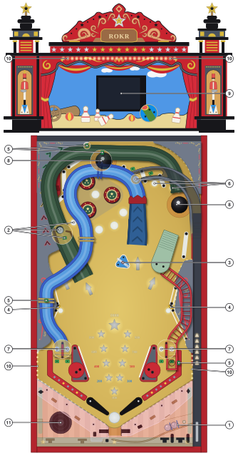

# ROKR 3D Pinball Modification

Modification of the Robotime ROKR Pinball Machine (EG01) wooden 3D-puzzle kit with custom electronics.

## Features

1. **Multiball:** two balls may be in play at the same time.
2. **Scoop:** a scoop catches the ball and holds it until the game throws it out with a coil.
3. **Rotating seal:** a shot that turns the seal scores, by how far and in which direction it turns.
4. **Stand-up targets:** the playfield gets stand-up targets, and the game sees every hit on one.
5. **Tracks:** all four tracks see the ball.
6. **Top lanes:** three top lanes each have a sensor and a light.
7. **Inlanes:** each of the four inlanes gets a light and a sensor.
8. **Bells:** each bell becomes a hit target.
9. **Screen and touch:** a 2.8 inch touch display shows the score, pictures, animations and videos. A game reacts to a tap on it.
10. **Ambient light:** RGB strips along the sides of the playfield and the diorama's ceiling run effects and palettes.
11. **Speaker:** the music and up to three effects play at once. The music goes on where an effect interrupted it.

[`docs/features.md`](docs/features.md) lists every feature, with the modes, the games and the light effects.

## Repository

This repository hosts everything for the project:

| Content | Location |
|---|---|
| Firmware: source, tests and code notes | [`firmware/`](firmware/) |
| Firmware design, one document per driver and component | [`docs/firmware/`](docs/firmware/) |
| PCB designs (schematics & layout) | [`hardware/pcb/`](hardware/pcb/) |
| 3D CAD files | [`hardware/cad/`](hardware/cad/) |
| Features of the modified machine | [`docs/features.md`](docs/features.md) |
| Documentation | [`docs/`](docs/) |
| Design, one directory per subsystem | [`docs/parts/`](docs/parts/) |
| Datasheets | [`docs/datasheets/`](docs/datasheets/) |
| Research | [`docs/research/`](docs/research/) |
| Part list (BOM) | [`docs/parts-list.md`](docs/parts-list.md) |
| Photos, renders & other assets | [`assets/`](assets/) |
| Checking tools | [`tools/`](tools/) |
| Arcade: the machine's features and games in the browser | [`tools/arcade/`](tools/arcade/) |

## Reversibility

The modification is planned to be reversible: the stock machine can be returned to its original functionality.

## Status

Early stage. Research and design in progress; nothing has been built yet.

The modification is built around a **Teensy 4.1** controller.

## Bench warnings

- Do not plug or unplug the Teensy while the machine is powered, and do not connect a powered board to an unpowered Teensy. Its pins must not carry voltage while it is off.
- With the Teensy connected powered from USB, ensure that grounds between Teensy and an externally powered board are connected.
- Do not use an adapter that puts out more than 5.5 V or is rated above 6 A. The power board has no overvoltage protection, and the Teensy's VIN ends at 5.5 V. Above 6 A a short on a board's feed wire no longer trips the adapter and overheats the wire.

## Disclaimer

This modification is developed with AI and in the context that electricity is involved, reuse any information at your own risk.

## License

MIT, see [LICENSE](LICENSE).
