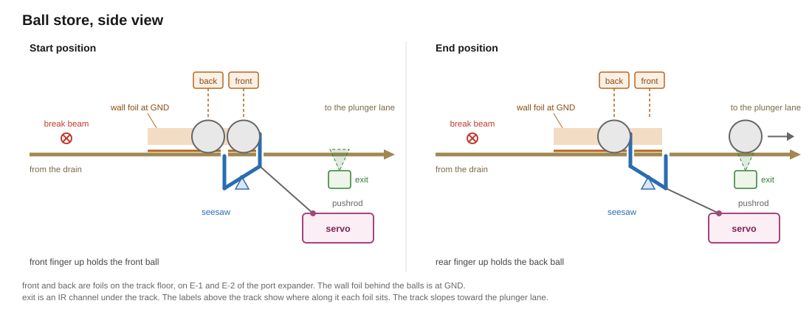

# Drain component

The drain component gives a game access to the drain and the ball store. It combines the [break beam](../drivers/break-beam.md) across the drain, the [servo](../drivers/servo.md) that works the ball separator, two foil contacts of the [contact driver](../drivers/contacts.md), one IR channel of the [IR ball sensing driver](../drivers/ir-sensing.md) and the drain lamp of the [lamps component](lamps.md). The host hands the events of these parts to this component alone, as [`game-abstraction.md`](../game-abstraction.md#playfield-components) describes.

## Requirements

The game wants to ...
- know when a ball leaves play.
- know how many balls the store holds.
- release one ball from the store into the plunger lane.
- know whether a released ball has passed the separator.
- control the drain lamp.

## Ball store

The machine can handle at most two balls. A ball leaves play through the drain, crosses the break beam and rolls into the store. The store holds both balls in a row in front of the ball separator, a seesaw that the servo tilts.

In the start position, the seesaw holds the balls back. In the end position, it lets the front ball roll into the plunger lane and holds the ball behind it back. The track's slope is slight, so the second ball may stay where it is instead of rolling up to the front.



Two foil contacts and one IR channel watch the store.

| Sensor | Kind | Sits | Reports |
|---|---|---|---|
| `front` | foil contact on E-1 | on the track floor between the seesaw's two fingers | a ball waiting at the front |
| `back` | foil contact on E-2 | on the track floor behind the rear finger | a second ball in the store |
| `exit` | IR channel | under the track past the seesaw, at the entry to the plunger lane | a released ball that has passed the seesaw |

A ball closes `front` or `back` by tying its floor foil to the wall foil at GND. The [ball store's hardware](../../parts/contacts/design.md#drain-ball-store) describes the foils.

`stored()` counts the balls that `front` and `back` hold at that moment. It reads the contacts' current state and counts no events, so a missed event leaves the count right. It is right from power-up on, with balls already in the store.

## Release

`release()` releases one ball. It moves the servo to its end position and waits for the `exit` channel to report the ball. The servo then returns to its start position, and the release ends once it has arrived there.

The release fails when `exit` reports no ball within the servo's travel time at the config's speed plus 2 s for the ball to roll. The servo then returns to its start position, and the component reports `ReleaseFailed`. Whether to try again is the game's decision. `stored()` still tells where the balls are.

The component checks in its `update()` whether the time is up. The [host](../game-abstraction.md#playfield-components) calls `update()` once per pass of the main loop.

`release()` refuses while a release is running and while the store is empty.

`BallStored` is raised when `front` or `back` reports a ball that was not in the store before. The component keeps the number of balls it has counted in. That number starts with the balls in the store when the main loop begins, after the [start-up](../general-design.md#main-program) with every coil's first pull. When `stored()` rises above that number, it raises one `BallStored` for each ball more. A `BallReleased` takes one ball off the number. A ball that rolls from `back` up to `front` takes up to 2 s for it. On the way it crosses the rear finger's slot between the two foils. While it is there, `stored()` reads one ball less. `stored()` never rises above the number, so that ball raises no `BallStored`. Two balls that drain together and cross the break beam as one `Drained` still raise two `BallStored`.

## Drain lamp

`lamp(mode)` gives the game the drain lamp, as the [lamps component](lamps.md#overlapping-effects) hands out every lamp.

## Pinball events

| Event | When | Payload |
|---|---|---|
| `Drained` | the break beam reports a ball leaving play | none |
| `BallStored` | a ball has arrived in the store | the balls in the store |
| `BallReleased` | `exit` reports the released ball | the balls left in the store |
| `ReleaseFailed` | `exit` has reported no ball in time | none |

Device faults stay with the host, as for every component. A beam that stays broken or a failed servo is therefore no event of this component.

## Interface

```cpp
// the drain with its break beam, the ball store, the ball separator and the drain lamp
class Drain : public Component {
public:
    // turns BallDrained into Drained, the store's contact closures into BallStored, and the exit's
    // IR event during a release into BallReleased
    bool    translate(const DriverEvent& in, PinballEvents& out) override;

    // sets the counted number in the first pass of the main loop, ends a release once the servo is
    // back, and makes ReleaseFailed once exit has reported no ball in time
    bool    update(uint32_t now, PinballEvents& out) override;

    uint8_t stored() const;       // gets the balls the store holds, read from front and back
    bool    release();            // releases one ball; false while a release runs or the store is empty
    bool    releasing() const;    // gets whether a release runs, the servo's return to its start position included
    Lamp    lamp(const Mode& mode);   // gets the drain lamp for the key and priority of mode
};
```
