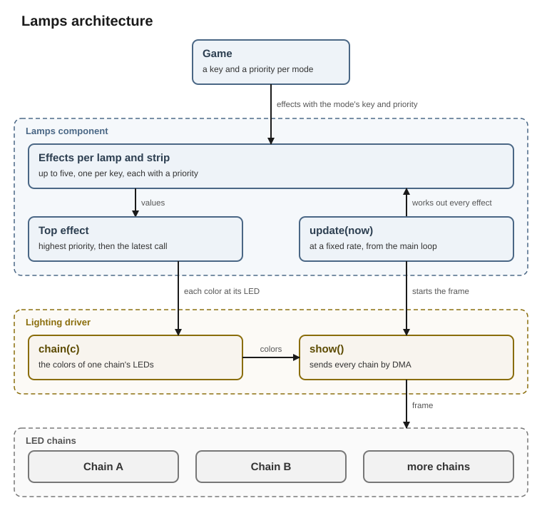

# Lamps

The lamps component organizes the machine's lamps in fixed groups and runs the effects on them. The game decides what every lamp shows. The [lighting driver](../drivers/lighting.md) sends the colors to the chains.



## Groups

The groups follow the [lighting design](../../parts/lighting/design.md#light-layout). Each lamp is one of the LEDs the light layout lists as lit. 

On the perimeters, the [lighting driver](../drivers/lighting.md)'s profile decides which LEDs are lamps: every second one with the 3 A adapter, every one with the 6 A adapter.

| Group | Type | Lamps |
|---|---|---|
| `perimeterLeft` | `Strip` | 40 or 79 along the left of the playfield frame, with the 3 A or the 6 A adapter |
| `perimeterRight` | `Strip` | 40 or 79 along the right of the playfield frame, with the 3 A or the 6 A adapter |
| `perimeter` | `Strip` | both perimeters as one, up the left, across the top and down the right |
| `ceiling` | `Strip` | 26 over the diorama |
| `ambient` | `Strip` | the perimeters and the ceiling as one, up the left, across the ceiling and down the right |
| `playfield` | `LampRange` | every single lamp on the playfield |

The [config](#config) places each group on a chain and gives it its LEDs. The playfield has three sections, lower, middle and upper, and its lamps follow in that order. A playfield lamp is one LED or several LEDs in a row of its section's chain. The playfield's lamps get named parts, such as the `drain` or `score`.

A strip may run hidden for a stretch. Its hidden LEDs stay dark and are no lamps. A run counts only the strip's lamps, so it crosses a hidden stretch at an even pace, without a pause.

A playfield section may hold hidden LEDs as well, such as LEDs left between two lights on an uncut strip. They stay dark and belong to no lamp. A lamp starts at the next LED that is not hidden, and a hidden LED inside its count ends it there.

Each perimeter's chain starts at the playfield's lower end. The ceiling's chain starts at its left end. A path through several strips leaves one lamp spacing between them.

The groups come in three types.

| Type | Lamps |
|---|---|
| `Lamp` | a single lamp |
| `LampRange` | several lamps of the playfield, such as the score. Each lamp keeps its own effect. `range[i]` gives one of them as a `Lamp` |
| `Strip` | a row of lamps along a path, such as a perimeter. An effect always covers the whole strip, so a strip cannot address a single lamp. |

## Effects

An effect defines how the color of a lamp or a strip changes over time. The lamps component provides different effects such as blinking or fading as separate calls. An effect runs until it ends or another effect replaces it. 

Every effect works on a single lamp as well as on several. The one exception is `run()`, which moves a pattern from lamp to lamp and therefore exists only on a `LampRange` and a `Strip`.

| Call | Effect |
|---|---|
| `set(c)` | lights steadily in color `c` |
| `off()` | turns the lamps dark |
| `blink(c, onMs, offMs, off)` | lights in `c` for `onMs`, then goes off for `offMs`, over and over. While off, the lamps are left as they are, or turn dark with `Off::DARK` |
| `alternate(a, b, aMs, bMs)` | lights in `a` for `aMs`, then in `b` for `bMs`, over and over |
| `pulse(a, b, periodMs)` | fades from `a` to `b` and back once per period |
| `fade(c, ms)` | fades from the current color to `c` within `ms` and stays there. A strip fades from the color its first lamp shows |
| `run(pattern, direction, c, step, back)` | moves a pattern in color `c` over the color `back`, such as a chase or an asteroid. `step` is the ms per lamp on a `LampRange` and the mm per second on a `Strip` |

An effect takes its colors as a `Paint`. A `Paint` is a single `Color` or one of FastLED's palettes, such as `RainbowColors_p`. For a single color, a call takes the color directly, as in `set(Color::RED)`.

A palette gives an effect many colors instead of one. Its colors change in one of three ways.

| The colors change | Chosen with |
|---|---|
| over time | `By::TIME` |
| along the lamps | `By::POSITION` |
| with the effect's brightness | `By::VALUE` |

`back` is optional for `run()`. Without it, the run leaves the lamps it does not light as they are.

`Color::dim(percent)` gives a color at a part of its brightness, such as `Color::RED.dim(30)` for 30 % red.

Every effect is a class derived from `Effect`. For each moment, an effect says how far a lamp stands between its two colors. The calls above start the built-in effects. `play(effect, from, to)` starts any effect, also one a game writes.

## Overlapping effects

Every lamp and every strip holds up to five effects at once, one for each mode of the game. If a lamp already holds an effect of the same mode, a new effect replaces it.

Each effect has the priority of its mode. The effect with the highest priority shows. Between equal priorities, the later call shows. The other effects lie below it and keep running while covered. When the effect on top ends, the next one shows.

A mode uses the lamps in three steps.

1. When the mode starts, it takes its groups from `lamps.groups(layer())`. Its [layer](../game-abstraction.md#modes) holds its key and its priority.
2. While the mode runs, it starts effects on those groups.
3. When the mode ends, the mode stack calls `lamps.remove(layer)`. Every effect of the mode leaves every lamp, and the effects below show again.

A lamp that already holds five effects refuses a sixth and counts it.

Two calls remove an effect before its mode ends.

| Call | Effect |
|---|---|
| `clear()` | removes the effect its mode set, so the effect below shows |
| `lasting(ms)` | removes the effect `ms` after the call, so a short show needs no second call to end |

Every effect call returns its lamps, so `lasting(ms)` can follow it, as in `flash.perimeter.pulse(a, b, periodMs).lasting(ms)`.

`Color::NONE` is the color for "leave this lamp to the effect below". `run()` takes it where a call leaves out `back`, and `blink()` shows it while off. `Color::BLACK` covers the effect below instead.

## Brightness

A game sets how bright the playfield lights and the ambient lights are, each from 0 to 1. The value is a share of the most the [lighting driver](../drivers/lighting.md#adapter-profile)'s profile allows, so 0.5 gives half of it. Both start at 1. `clear()` sets them back to 1 between two games.

## Frames

The main loop calls `update(now)` in every pass. Every 10 ms, `update()` works out what every effect shows at that moment, from the time since the effect began. The lamps change only when `update()` works out a new frame. For each lamp, it writes the color of its top effect into the lamp's chain. A lamp of the perimeters or the ceiling gets its color scaled to the ambient brightness, a lamp of the playfield to the playfield brightness. `update()` then hands the frame to the lighting driver without waiting.

10 ms were chosen so that every frame has been sent well before the next one starts. `show()` therefore never has to wait. Sending a frame takes at most 2.75 ms for the longest chain in the machine. 10 ms are also short enough for fades and runs to change smoothly. A shorter period would only take more time from the main loop.

## Config

Each group's chain and LEDs stand in the [machine config](config.md), under `lamps.perimeter_left`, `lamps.perimeter_right`, `lamps.ceiling`, `lamps.playfield_lower`, `lamps.playfield_middle` and `lamps.playfield_upper`:

```yaml
lamps:
  perimeter_left:  { chain: A, leds: …, gaps: [[…, …], …] }
  playfield_lower: { chain: D, leds: …, lamps: [1, 2, 1, …] }
```

| Key under a group | Default | Range |
|---|---|---|
| `chain` | none | A to F |
| `leds` | none | 0 to 160 LEDs |
| `lamps` | none | playfield sections only: one count per lamp, each 1 to 160 LEDs |
| `gaps` | none | the hidden stretches, each as its first LED and its count |

A group without a chain holds no lamps. A chain carries one group, so a later group that names a taken chain holds no lamps. The lighting driver takes each chain's LEDs from the groups.

`begin()` writes a line to the [log](../logging.md) for each mistake it finds in the groups, and goes on. A group on a chain past F or on a taken chain holds no lamps. A lamp count of 0 takes 1 LED. A gap or the chain's end cuts a lamp short. A count past a section's last LED goes unused. Until the logger stands as code, a debug build prints these lines.

On the playfield, every LED past a section's last count is one lamp. A count past the chain's end is cut there.

> [!TODO]
> The groups' chains, LEDs, lamps and gaps follow once the [light layout](../../parts/lighting/design.md#light-layout) is final.

## Interface

The component is the library [`firmware/lib/lamps/`](../../../firmware/lib/lamps/). Its interface stands in [`lamps.h`](../../../firmware/lib/lamps/lamps.h).
