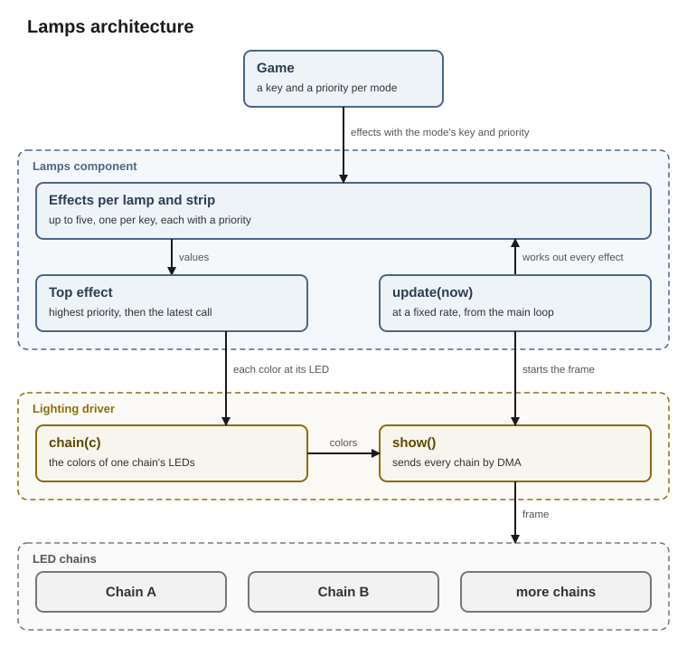

# Lamps

The lamps component organizes the machine's lamps in fixed groups and runs the effects on them. The game decides what every lamp shows. The [lighting driver](../drivers/lighting.md) sends the colors to the chains.



## Groups

The groups follow the [lighting design](../../parts/lighting/design.md#light-layout). Each lamp is one of the LEDs the light layout lists as lit. 

On the perimeters, every second LED is treated as a controllable lamp.

| Group | Type | Lamps |
|---|---|---|
| `perimeterLeft` | `Strip` | 40 along the left of the playfield frame |
| `perimeterRight` | `Strip` | 40 along the right of the playfield frame |
| `perimeter` | `Strip` | both perimeters as one, up the left, across the top and down the right |
| `ceiling` | `Strip` | 26 over the diorama |
| `ambient` | `Strip` | the perimeters and the ceiling as one, up the left, across the ceiling and down the right |
| `playfield` | `LampRange` | every single lamp on the playfield |

The playfield's lamps get named parts, such as the `drain` or `score`.

The groups come in three types.

| Type | Lamps |
|---|---|
| `Lamp` | a single lamp |
| `LampRange` | several lamps of the playfield, such as the score. Each lamp keeps its own effect. `range[i]` gives one of them as a `Lamp` |
| `Strip` | a row of lamps along a path, such as a perimeter. An effect always covers the whole strip, so a strip cannot address a single lamp. |

## Effects

An effect defines how the color of a lamp or a strip changes over time. The lamps component provides different effects such as blinking or fading as separate calls. An effect runs until it ends or another effect replaces it. 

Every effect works on a single lamp as well as on several. The one exception is `run()`, which moves a pattern from lamp to lamp and therefore exists only on a `LampRange` and a `Strip`.

| Call | Effect |
|---|---|
| `set(c)` | lights steadily in color `c` |
| `off()` | turns the lamps dark |
| `blink(c, onMs, offMs, off)` | lights in `c` for `onMs`, then goes off for `offMs`, over and over. While off, the lamps are left as they are, or turn dark with `Off::Dark` |
| `alternate(a, b, aMs, bMs)` | lights in `a` for `aMs`, then in `b` for `bMs`, over and over |
| `pulse(a, b, periodMs)` | fades from `a` to `b` and back once per period |
| `fade(c, ms)` | fades from the current color to `c` within `ms` and stays there |
| `run(pattern, direction, c, step, back)` | moves a pattern in color `c` over the color `back`, such as a chase or an asteroid. `step` is the ms per lamp on a `LampRange` and the mm per second on a `Strip` |

An effect takes its colors as a `Paint`. A `Paint` is a single `Color` or one of FastLED's palettes, such as `RainbowColors_p`. For a single color, a call takes the color directly, as in `set(Color::red)`.

A palette gives an effect many colors instead of one. Its colors change in one of three ways.

| The colors change | Chosen with |
|---|---|
| over time | `By::Time` |
| along the lamps | `By::Position` |
| with the effect's brightness | `By::Value` |

`back` is optional for `run()`. Without it, the run leaves the lamps it does not light as they are.

`Color::dim(percent)` gives a color at a part of its brightness, such as `Color::red.dim(30)` for 30 % red.

Every effect is a class derived from `Effect`. For each moment, an effect says how far a lamp stands between its two colors. The calls above start the built-in effects. `play(effect, from, to)` starts any effect, also one a game writes.

## Overlapping effects

Every lamp and every strip holds up to five effects at once, one for each key. A key names the mode of the game that set the effect. If a lamp already holds an effect with the same key, a new effect replaces it.

Each effect also has a priority. The effect with the highest priority shows. Between equal priorities, the later call shows. The other effects lie below it and keep running while covered. When the effect on top ends, the next one shows.

The game gives each of its modes its own key and priority and uses the lamps in three steps.

1. When a mode starts, the game takes the groups for the mode's key and priority from `lamps.groups(key, priority)`.
2. While the mode runs, the game starts effects on those groups.
3. When the mode ends, the game calls `lamps.remove(key)`. Every effect of the mode leaves every lamp, and the effects below show again.

A lamp that already holds five effects refuses a sixth and counts it.

Two calls remove an effect before its mode ends.

| Call | Effect |
|---|---|
| `clear()` | removes the effect its key set, so the effect below shows |
| `lasting(ms)` | removes the effect `ms` after the call, so a short show needs no second call to end |

Every effect call returns its lamps, so `lasting(ms)` can follow it, as in `flash.perimeter.pulse(a, b, periodMs).lasting(ms)`.

`Color::none` is the color for "leave this lamp to the effect below". `run()` takes it where a call leaves out `back`, and `blink()` shows it while off. `Color::black` covers the effect below instead.

## Frames

The main loop calls `update(now)` in every pass. Every 10 ms, `update()` works out what every effect shows at that moment, from the time since the effect began. The lamps change only when `update()` works out a new frame. For each lamp, it writes the color of its top effect into the lamp's chain. `update()` then hands the frame to the lighting driver without waiting.

10 ms were chosen so that every frame has been sent well before the next one starts. `show()` therefore never has to wait. Sending a frame takes at most 2.67 ms for the longest chain in the machine. 10 ms are also short enough for fades and runs to change smoothly. A shorter period would only take more time from the main loop.

## Interface

```cpp
// a color of a lamp, 8 bits for each of red, green and blue
struct Color {
    uint8_t r = 0, g = 0, b = 0;
    bool    below = false;   // shows the effect below instead of a color, as Color::none does

    constexpr Color dim(uint8_t percent) const;   // gets the color at percent of its brightness

    static const Color black, white, red, green, blue, amber, none;
};

enum class By : uint8_t { Time, Position, Value };   // what picks a palette's color: the time, the lamp's place, or the effect's value

// what an effect paints with: a single color, or the colors of a palette; a single Color is passed as it is
struct Paint {
    Paint(Color c);
    Paint(const TProgmemRGBPalette16& palette, By by);   // one of FastLED's palettes, such as RainbowColors_p
};

enum class Pattern : uint8_t { Chase, Asteroid, Wipe };   // the patterns run() moves along a range
enum class Direction : uint8_t { Up, Down };               // Up runs toward the higher lamp numbers
enum class Off : uint8_t { Through, Dark };              // what a blink shows while off: the effect below, or a dark lamp

// where a lamp lies among the lamps an effect covers, for an effect that moves along them
struct Spot {
    uint16_t index;     // the lamp's place, 0 for the first
    uint16_t count;     // how many lamps the effect covers
    uint32_t mmQ;       // a strip lamp's position along its strip in quarter millimeters, 0 on the playfield
    uint32_t lengthQ;   // the position of the strip's last lamp, 0 on the playfield
};

// what every effect is; Steady, Blink, Pulse, Fade and Run are the built-in ones
class Effect {
public:
    // gets 0 for the first color, 255 for the second, or a value between, ms after the effect began
    virtual uint8_t value(uint32_t ms, const Spot& at) const = 0;
};

// a single lamp, to which effects go with one key and priority
class Lamp {
public:
    template <typename E> Lamp& play(const E& effect, Paint from, Paint to);   // starts an effect that mixes from into to
    Lamp& set(Paint c);                                     // lights steadily in c
    Lamp& off();                                            // turns dark
    Lamp& blink(Paint c, uint16_t onMs, uint16_t offMs, Off off = Off::Through);   // lights in c for onMs, then goes off for offMs, over and over
    Lamp& alternate(Paint a, Paint b, uint16_t aMs, uint16_t bMs);   // lights in a for aMs, then in b for bMs, over and over
    Lamp& pulse(Paint a, Paint b, uint16_t periodMs);       // fades from a to b and back once per period
    Lamp& fade(Paint c, uint16_t ms);                       // fades from the current color to c within ms
    void  lasting(uint16_t ms);                             // removes the effect ms from now
    void  clear();                                          // removes the effect its key set, so the one below shows
};

// some lamps of one group, to which effects go with one key and priority
class LampRange {
public:
    Lamp      operator[](uint16_t i) const;                 // gets one lamp of the range
    LampRange sub(uint16_t first, uint16_t count) const;    // gets a part of the range
    uint16_t  size() const;                                 // gets how many lamps the range holds

    template <typename E> LampRange& play(const E& effect, Paint from, Paint to);   // starts an effect that mixes from into to

    LampRange& set(Paint c);                                // lights every lamp steadily in c
    LampRange& off();                                       // turns every lamp dark
    LampRange& blink(Paint c, uint16_t onMs, uint16_t offMs, Off off = Off::Through);   // lights in c for onMs, then goes off for offMs, over and over
    LampRange& alternate(Paint a, Paint b, uint16_t aMs, uint16_t bMs);   // lights in a for aMs, then in b for bMs, over and over
    LampRange& pulse(Paint a, Paint b, uint16_t periodMs);  // fades from a to b and back once per period
    LampRange& fade(Paint c, uint16_t ms);                  // fades from the current color to c within ms
    LampRange& run(Pattern p, Direction d, Paint c, uint16_t stepMs, Paint back = Color::none);   // moves the pattern in c over back by one lamp per step
    void       lasting(uint16_t ms);                        // removes the effects ms from now
    void       clear();                                     // removes the effects its key set, so the ones below show
};

// a strip of lamps that an effect runs along as a whole
class Strip {
public:
    uint16_t size() const;                                  // gets how many lamps the strip holds

    template <typename E> Strip& play(const E& effect, Paint from, Paint to);   // starts an effect that mixes from into to

    Strip& set(Paint c);                                    // lights the strip steadily in c
    Strip& off();                                           // turns the strip dark
    Strip& blink(Paint c, uint16_t onMs, uint16_t offMs, Off off = Off::Through);   // lights in c for onMs, then goes off for offMs, over and over
    Strip& alternate(Paint a, Paint b, uint16_t aMs, uint16_t bMs);   // lights in a for aMs, then in b for bMs, over and over
    Strip& pulse(Paint a, Paint b, uint16_t periodMs);      // fades from a to b and back once per period
    Strip& fade(Paint c, uint16_t ms);                      // fades from the current color to c within ms
    Strip& run(Pattern p, Direction d, Paint c, uint16_t mmPerS, Paint back = Color::none);   // moves the pattern in c over back along the strip at mmPerS millimeters a second
    void   lasting(uint16_t ms);                            // removes the effect ms from now
    void   clear();                                         // removes the effect its key set, so the one below shows
};

// the lamp groups, to which effects go with one key and priority
struct LampGroups {
    Strip     perimeterLeft, perimeterRight, ceiling;
    Strip     perimeter;    // both perimeters as one: up the left, across the top, down the right
    Strip     ambient;      // the perimeters and the ceiling as one: up the left, across the ceiling, down the right
    LampRange playfield;
    // the named parts of playfield follow once the lamp positions are fixed
};

// the machine's lamps, each lamp and each strip with up to five effects at once
class Lamps {
public:
    explicit Lamps(Lighting& lighting);

    // gets the groups to which effects go with key and priority
    LampGroups groups(uint8_t key, uint8_t priority);

    void     remove(uint8_t key);   // removes every effect with key from every lamp and strip, so the ones below show
    uint32_t refused() const;       // gets how many effects a lamp or strip with five effects has refused
    void     clear();               // removes every effect from every lamp and strip; the host calls it between two games

    // works out every effect and hands on a frame once a frame period has passed; the main loop calls it in every pass
    void update(uint32_t now);
};
```
