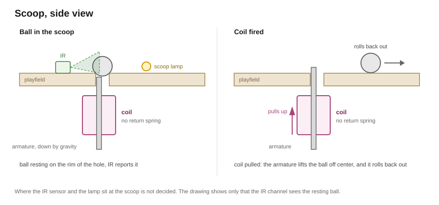

# Scoop component

The scoop component gives a game access to the scoop. It combines the unsensed coil of the [solenoid driver](../drivers/solenoid.md), one IR channel of the [IR ball sensing driver](../drivers/ir-sensing.md) and the scoop lamp of the [lamps component](lamps.md). The host hands the events of these parts to this component alone, as [`game-abstraction.md`](../game-abstraction.md#playfield-components) describes.

## Requirements

The game wants to ...
- know when a ball enters the scoop.
- know how long a ball has been in the scoop.
- know when a ball leaves the scoop, and how long it stayed.
- fire the scoop's coil.
- control the scoop lamp.

## Ball in the scoop

The IR channel sees a ball resting in the scoop and reports it while it rests there.



`holding()` tells whether a ball rests in the scoop. `heldMs()` gives how long it has rested there. Both read the channel's current state, so they are right from power-up on, with a ball already in the scoop.

## Eject

`fire()` pulls the scoop's coil once. The coil's armature throws the ball out of the scoop, and gravity returns the armature. `fire()` pulls the coil whether a ball rests in the scoop or not, so a game can also fire it for show. It returns false while the coil is still on or cooling down, as the [solenoid driver](../drivers/solenoid.md#solenoid-protection) sets out.

A ball that leaves the scoop raises `BallLeftScoop`. A ball still resting after a pull has not been thrown out, and a game that wants it out fires again.

## Scoop lamp

`lamp()` hands the game the lamps component's `scoop` lamp, with all its [effects](lamps.md#effects).

## Pinball events

| Event | When | Payload |
|---|---|---|
| `BallInScoop` | the IR channel reports a ball arriving | none |
| `BallLeftScoop` | the IR channel reports the ball gone | how long it stayed, in milliseconds |

## Interface

```cpp
// the scoop with its IR channel, its unsensed coil and its lamp
class Scoop : public Component {
public:
    // turns the channel's Detected into BallInScoop and its Released into BallLeftScoop
    bool     translate(const DriverEvent& in, PinballEvents& out) override;

    bool     holding() const;     // gets whether a ball rests in the scoop
    uint32_t heldMs() const;      // gets how long the ball has rested there, in milliseconds; 0 without one
    bool     fire();              // pulls the coil once; false while it is still on or cooling down
    Lamp&    lamp();              // gets the scoop lamp
};
```
