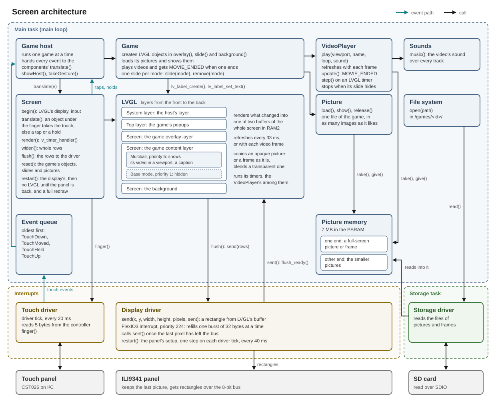

# Screen component

The screen component runs [LVGL](https://lvgl.io) on the display. LVGL is a library for user interfaces. It draws text, pictures, shapes and controls such as buttons and sliders from objects that a game or the host creates. The screen component gives the game and the host their places for these objects and sends what LVGL draws through the [display driver](../drivers/display.md). It also keeps the game's pictures in its picture memory and turns touches into LVGL's input and into taps and holds.

## Layers

A layer is an area the size of the screen that holds objects. It is transparent where it has no object, so the layer behind it shows through there. From the front, the screen shows the host's layer, the game overlay layer, the game content layer and the game's background.

`hostLayer()` gives the host its layer for the menu. `overlay()` gives the game the overlay layer, for what stays visible over every slide, such as the score. `slide(mode)` gives the game a [slide](#slides) on the content layer, which shows one slide at a time. `background()` gives the game the layer behind everything else.

`showOverlay()` and `showHost()` show or hide a layer without losing its objects. LVGL's popups lie between the game overlay layer and the host's layer.

When the host switches games, the component deletes the stopped game's objects and slides and releases its pictures, so a game cleans up nothing itself.

## Slides

A slide is a page of objects that one mode of the game fills, such as the screen of a multiball. Every slide lies in the game content layer. Several modes can hold a slide at once. Only one slide shows. The game overlay layer lies in front of it, so what the game puts there stays visible over every slide, such as the score.

The screen keeps the slides in a [priority list](../general-design.md#priority-lists). The slide of the mode with the highest [priority](../game-abstraction.md#modes) shows. Between equal priorities, the later slide shows. The other slides lie hidden below it. They keep their objects and their pictures. Their controls take no touch. An animation the game starts with `animate()` pauses while its slide lies hidden and goes on where it stood once the slide shows again. LVGL offers no way to find the animations of a slide, so the screen follows only those started through it. When the slide on top is removed, the next one shows.

A mode uses its slide in three steps.

1. When the mode starts, it takes its slide from `slide(layer())`. A second call for the same mode gets the same slide.
2. While the mode runs, it puts its objects on that slide. A [video](video-player.md) plays in a viewport on it.
3. When the mode ends, the [mode stack](../game-abstraction.md#modes) calls `remove(mode)`. The slide leaves with its objects. The slide below then shows.

## Drawing

The game and the host place and update labels, images, buttons, lines and other LVGL objects on their layers. LVGL redraws only the parts of the screen that changed. It draws in RGB565 with smooth edges. Every object may be partly transparent.

LVGL draws in the main loop, in `render()`. It keeps two buffers of the whole screen in RAM2 and draws the next picture into one while the driver sends the other. LVGL copies what changed into the other buffer itself. Each refresh hands the driver one rectangle: the whole width of the rows from the first changed row to the last. LVGL never waits for the driver, because even a whole screen has left the bus before the next refresh. A whole screen takes 12.8 ms on the bus. LVGL refreshes the screen every 33 ms.

When the player presses a button, LVGL calls the function the game or the host gave that button. LVGL calls it from `render()`, so it runs in the main task like every other call into the game.

## Pictures

A picture is an image file the game loads, such as a background or an icon. LVGL shows a loaded picture in an `Image` object. The game can show the same picture at several places on the screen at once. A picture file is stored on the SD card in LVGL's image format. The game opens it through the [file system](file-system.md). [`media.md`](../../../assets/media.md) explains how create such files from a PNG file.
The game's pictures and the frames of a video lie in the screen's picture memory. It's located in the [PSRAM](../../parts/psram/design.md), in what the log's buffers and the sound's rings leave. An opaque full-screen picture takes 150 KB, so the memory holds up to 48 pictures.

A `Picture` holds one picture file in the picture memory. `load()` reserves memory for the picture, starts reading the file into it and returns at once. `loading()` is true until the picture has loaded. A file that is missing or short, or a full picture memory, makes `failed()` true. `show()` puts the picture on the layer or into the object the game passes, such as its background or a button. The game may call `show()` before the picture has loaded. The picture then appears as soon as it has loaded. `release()` takes the picture off the screen everywhere it is shown and frees its memory. A picture that is still loading frees its memory once it has loaded. A `Picture` stays known to the screen from its first `load()` on, so it lives as long as the firmware.

When Teensyduino finds no PSRAM at start-up, every picture fails to load.

## Touch

A touch that comes down on a control goes to that control until the finger leaves the screen. A control is an LVGL object that takes touches, such as a button of the game or of the host's menu. Only the point where the finger comes down counts. A finger that comes down beside a control and slides onto it afterwards does not press it.

Every other touch becomes a tap or a hold, which reaches the game as a pinball event. A tap is a touch that leaves the screen within 500 ms and within 10 pixels of where it came down. A hold is a finger resting for 1 s, which the touch driver reports as `TouchHeld`. The host also takes every tap and hold with `takeGesture()`, so it can react to a gesture over a running game.

A touch that comes down in the right 24 px and moves 10 px or more to the left is the host's swipe. It opens the [host's menu](../../../firmware/src/host/views/edge-menu-view.h). The component watches every touch before LVGL gets it, so it can tell the swipe apart. The swipe reaches neither LVGL nor the game. The host follows the finger's x while it moves. A tap or a hold that comes down at the right edge reaches the game as anywhere else.

| Event | When | Payload |
|---|---|---|
| `ScreenTapped` | A tap that no control took | x in the lower 16 bits and y in the upper 16 |
| `ScreenHeld` | A hold that no control took | x and y as for `ScreenTapped` |

## Interface

[`components/screen.h`](../../../firmware/src/components/screen.h) holds `Screen` and `Picture`.
