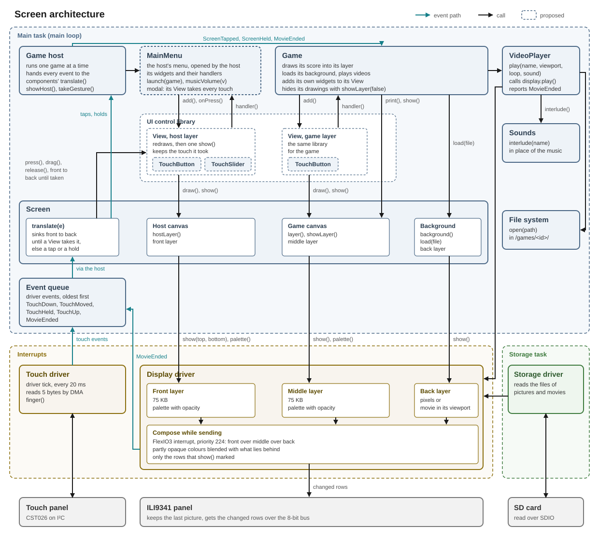

# Screen component



The screen component runs [LVGL](https://lvgl.io) on the display. LVGL is a library for user interfaces. It draws text, pictures, shapes and controls such as buttons and sliders from objects that a game or the host creates. The screen component gives the game and the host their places for these objects and sends what LVGL draws through the [display driver](../drivers/display.md). It also keeps the game's pictures in its picture memory and turns touches into LVGL's input and into taps and holds.

## Layers

A layer is an area the size of the screen that holds objects. It is transparent where it has no object, so the layer behind it shows through there. The screen has three layers. From the front, they are the host's layer, the game's layer and the game's background. A [video](video-player.md) plays between the game's background and the game's layer.
`layer()` and `background()` give the game its two layers. `hostLayer()` gives the host its own. `showLayer()` and `showHost()` show or hide a layer without losing its objects. LVGL's popups lie between the game's layer and the host's. 

When the host switches games, the component deletes the stopped game's objects and releases its pictures, so a game cleans up nothing itself.

## Drawing

The game and the host place and update labels, images, buttons, lines and other LVGL objects on their layers. LVGL redraws only the parts of the screen that changed. It draws in RGB565 with smooth edges. Every object may be partly transparent.

LVGL draws in the main loop, in `update()`. It keeps two buffers of the whole screen in RAM2 and draws the next picture into one while the driver sends the other. LVGL copies what changed into the other buffer itself. The component hands the full-width of the affected rows to the driver. LVGL never waits for the driver, because even a whole screen has left the bus before the next refresh. A whole screen takes 12.8 ms on the bus. LVGL refreshes the screen every 33 ms.

When the player presses a button, LVGL calls the function the game or the host gave that button. LVGL calls it from `update()`, so it runs in the main task like every other call into the game.

## Pictures

A picture is an image file the game loads, such as a background or an icon. LVGL shows a loaded picture in an `Image` object. The game can show the same picture at several places on the screen at once. A picture file is stored on the SD card in LVGL's image format. The game opens it through the [file system](file-system.md). [`media.md`](../../../assets/media.md) explains how create such files from a PNG file.
The game's pictures and the frames of a video lie in the screen's picture memory. It's located in the [PSRAM](../../parts/psram/design.md), where 8 MB are available. An opaque full-screen picture takes 150 KB, so the memory can holds up to 54 pictures.

A `Picture` holds one picture file in the picture memory. `load()` reserves memory for the picture, starts reading the file into it and returns at once. `loading()` is true until the picture has loaded. A file that is missing or short, or a full picture memory, makes `failed()` true. `show()` puts the picture on the layer or into the object the game passes, such as its background or a button. The game may call `show()` before the picture has loaded. The picture then appears as soon as it has loaded. `release()` takes the picture off the screen everywhere it is shown and frees its memory. A picture that is still loading frees its memory once it has loaded.

When Teensyduino finds no PSRAM at start-up, every picture fails to load.

## Touch

A touch that comes down on a control goes to that control until the finger leaves the screen. A control is an LVGL object that takes touches, such as a button of the game or of the host's menu. Only the point where the finger comes down counts. A finger that comes down beside a control and slides onto it afterwards does not press it.

Every other touch becomes a tap or a hold, which reaches the game as a pinball event. A tap is a touch that leaves the screen within 500 ms and within 10 pixels of where it came down. A hold is a finger resting for 1 s, which the touch driver reports as `TouchHeld`. The host also takes every tap and hold with `takeGesture()`, so it can react to a gesture over a running game.

| Event | When | Payload |
|---|---|---|
| `ScreenTapped` | A tap that no control took | x in the lower 16 bits and y in the upper 16 |
| `ScreenHeld` | A hold that no control took | x and y as for `ScreenTapped` |

## Interface

```cpp
// a picture file in the screen's picture memory, shown in as many LVGL images as the game likes
class Picture {
public:
    explicit Picture(Screen& screen);

    void      load(const FileReader& picture);   // reserves memory for the picture, starts reading the file into it and returns at once
    lv_obj_t* show(lv_obj_t* parent);        // creates an image of the picture inside parent, to place like any LVGL object
    void      release();                     // deletes every image of the picture and frees its memory, once the picture has loaded
    bool      loading() const;               // gets whether the picture still loads
    bool      failed() const;                // gets whether the last load found no file, a short one or a full picture memory
};

// LVGL on the display: the game's layer and background, and the host's layer over them
class Screen : public Component {
public:
    Screen(Display& display, Touch& touch);

    void begin();                            // starts LVGL on the display driver

    // takes every touch event; hands a touch to LVGL when an object lies under the finger where
    // it comes down, and makes one that none took into ScreenTapped or ScreenHeld
    bool translate(const DriverEvent& in, PinballEvents& out) override;

    // runs LVGL: its timers, the handlers of its controls and the redraw, except while the display
    // restarts; the main loop calls it in every pass
    void update();

    lv_obj_t* layer();                       // gets the game's layer, the parent of the game's objects
    lv_obj_t* background();                  // gets the game's background, the parent of what lies behind everything else
    void      showLayer(bool shown);         // shows or hides the game's layer; hidden, it keeps its objects

private:
    friend class GameHost;

    enum class Gesture : uint8_t { None, Tap, Hold };

    lv_obj_t* hostLayer();                   // gets the parent of the host's objects
    bool      settled() const;               // gets whether the picture memory is empty
    void      showHost(bool shown);          // shows or hides the host's layer
    Gesture   takeGesture(uint16_t& x, uint16_t& y);   // gets the host the last gesture once, None when there is none
    void      reset();                       // deletes the game's objects, releases its pictures and shows the game's layer
    void      restart();                     // sets the display up again after a supervisor reset and sends the whole picture again once it is back; returns at once
};
```
