# Host screens

The host's screens let the player choose a game, set sound and lights, and see what the machine reports. They take their colors from the cabinet, from the PINBALL logo and from the diorama screen in the boot film, so the display reads as part of the machine. Every screen is drawn at the display's 320 × 240 pixels in RGB565, as the pictures below show it. The screen component's [host layer](components/screen.md) holds them in front of the game's layers.

## Look

### Colors

| Name | Hex | Use | Taken from |
|---|---|---|---|
| night | `#0e061a` | Background of every host screen | Boot film, background of the diorama screen |
| velvet | `#2c0a46` | Tiles, list rows, the second ray | Boot film, violet ray of the diorama screen |
| ray | `#781228` | First ray of the sunburst | Boot film, crimson ray of the diorama screen |
| frame | `#c8242f` | Header band, dialog strip, curtain | [`dio-frame.svg`](../../assets/playfield/parts/dio-frame.svg) |
| cabinet | `#b3242d` | Button fill | [`cabinet.svg`](../../assets/playfield/parts/cabinet.svg), the walls |
| shadow | `#5e1016` | Button edge, pressed button | [`cabinet.svg`](../../assets/playfield/parts/cabinet.svg), the shadow |
| gold | `#e8c04a` | Rims, icons, primary button | Logo, the flipper's gold line |
| bulb | `#ffd65a` | Lit marquee bulb, selection | Boot film, lit bulb of the diorama screen |
| bulb off | `#5a3c1e` | Unlit marquee bulb | Boot film, unlit bulb of the diorama screen |
| cream | `#fff4d6` | Text | Logo, cream |
| cyan | `#78ffe6` | Numbers: score, percent, counts | Boot film, score digits of the diorama screen |
| ramp | `#3d82cf` | Sound slider fill | [`ramp-blue.svg`](../../assets/playfield/parts/ramp-blue.svg) |
| board | `#e2c76b` | Light slider fill, star icon | [`cabinet.svg`](../../assets/playfield/parts/cabinet.svg), the playfield board |
| green | `#3fa66b` | Warning light: works | [`cover-left.svg`](../../assets/playfield/parts/cover-left.svg) |
| neon | `#d63a48` | Warning light: failed, fault rim | Logo, the PINBALL neon |
| amber | `#ff9a2e` | Warning light: warning | Chosen to stand apart from gold and red |

### Controls

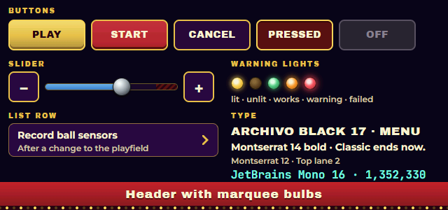

- **A touch target is at least 44 × 44 px**, about the size of a fingertip. Buttons and rows stand at least 4 px apart.
- **A button** is a plaque with a 2 px gold rim and 8 px corners, as the score box on the film's diorama screen. Red is the normal button, gold the one the page is for, and violet the way out. A pressed plaque sinks to the shadow red.
- **The header** is the diorama frame's red band, 34 px high, over a strip of marquee bulbs. Back sits top left. The gear and the menu's close sit top right.
- **A slider** has a violet track and a steel ball as its knob. Its fill is ramp blue for sound and board gold for light. A 44 px minus and plus stand beside it, each a step of 5 %.
- **A warning light** is a marquee bulb: green for a device that works, amber for a warning and red for a failed device. A failed device also turns its frame neon red, as the PINBALL tubes.
- **A dialog** is a night card with the red title strip. A fault dialog glows neon red.
- **Type** is English. Arial Black sets titles and buttons, as the film's MULTIBALL. Montserrat sets text at 14 px and never below 12 px. LVGL brings Montserrat in even sizes. Consolas Bold sets numbers in cyan, as the film's score. Arial Black and Consolas Bold are converted for LVGL with `lv_font_conv`.
- **Motion** stays short. The menu follows the finger in from the right edge and snaps open or back in 150 ms. Pages slide sideways in 150 ms. Toasts drop in from the top in 200 ms.

## Flow

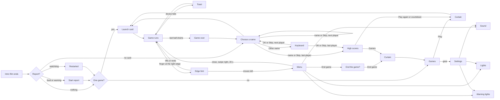

## Start-up

After the intro film the host shows at most one report and then its game choice. When only one game can run, the curtain opens on that game at once.

### Intro film ends

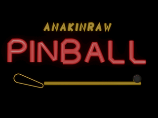

The host does its start-up work while the [boot film](game-abstraction.md#host) plays. When the film ends, the host shows the [start report](#start-report), [Restarted](#restarted) or [No memory card](#no-memory-card) if there is something to report. Otherwise it shows the [game choice](#games), or the [launch card](#launch-card) when only one game can run.

### Start report

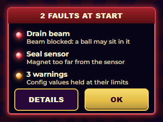

The report shows once when a device failed at start or a warning was logged. OK leads on as after the film. Details opens the [warning lights](#warning-lights).

### Restarted

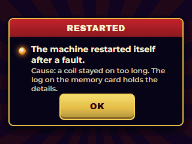

The screen shows once after the watchdog restarted the machine, with the cause from `CrashReport`. OK leads on as after the film.

### No memory card

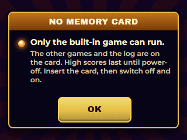

The firmware carries a built-in game. Without a card the machine warns once and runs that game, whose high scores then last until power-off. The status bulb stays amber while the card is missing. OK opens the [launch card](#launch-card) of the built-in game.

### Launch card

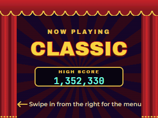

The curtain opens on the game's name and high score at every start of a game. The card stays about 1.5 s and names the swipe for the menu. It then gives way to the game's screen.

## Host

The game choice is the host's screen while no game runs. Settings lie behind the gear.

### Games

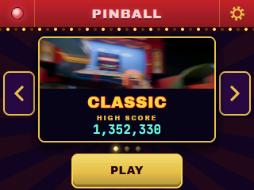

Each game has a card with its cover picture, its name and its high score. The built-in game is always the first card. A swipe or the arrows move between the cards. The bulbs below show which card is shown. The status bulb top left shows while a device is failed. Play closes the [curtain](#curtain) and opens it on the [launch card](#launch-card). The gear opens [Settings](#settings). The bulb opens the [warning lights](#warning-lights).

### A game that cannot start

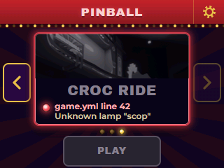

A game whose `game.yml` the loader rejects has a grey card. The card names the line and the first error. Play stays off.

### Curtain

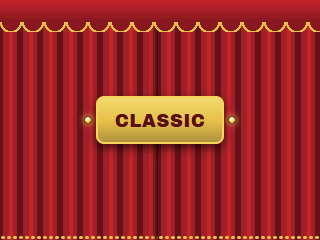

Every start and every exit of a game passes the closed curtain. It closes in 250 ms, holds 200 ms with a gold plaque naming where the machine goes, and opens in 300 ms. Behind it the host stops the old game and clears the screen. It opens on the [launch card](#launch-card) when a game starts and on the [game choice](#games) when a game is left.

### Settings

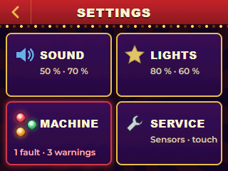

Four tiles show Sound, Lights, Machine and Service, each with its current state. The Machine tile glows red while a device is failed. Back leads to the [game choice](#games).

## In a game

The game keeps running whatever the host shows. Over a game the host shows a status bulb, the card indicator and the menu that a swipe pulls in.

### Game runs

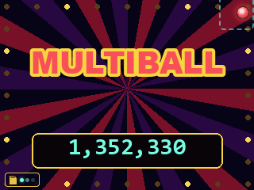

Nothing marks the right edge while nobody touches it. The status bulb top right shows while a device is failed. A tap on its 44 px area opens the [warning lights](#warning-lights). The card indicator bottom left shows while the card is being written.

### A finger at the right edge

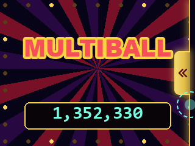

A finger that comes down in the right 24 px makes a gold tab and the menu's edge fade in within 150 ms, so the player sees where the menu comes from. A finger that lifts or rests there leaves the hint standing for 1 s. The hint then fades in 300 ms. The game then gets its tap or hold as anywhere else. A finger that moves 10 px or more to the left starts the [swipe](#swipe). That touch reaches no game. The screen component detects the swipe before LVGL gets the touch, as its section on [touch](components/screen.md#touch) gives.

### Swipe

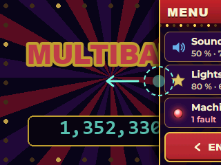

The menu follows the finger in from the right edge. A finger let go past half the menu's width snaps the menu open. A finger let go before that lets it slide back.

### Menu

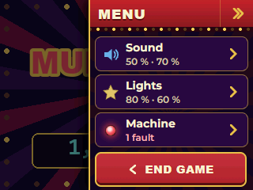

The menu is a drawer 208 px wide. The game stays visible and running beside it. Sound, Lights and Machine open their pages. End game asks first. Close, a swipe to the right, a tap on the game or 20 s without a touch close the menu.

### End the game

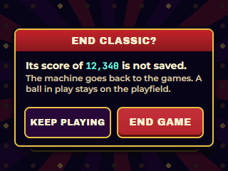

Ending a game in Play skips its `end()`, so its score is not saved. The host asks every time. End game closes the [curtain](#curtain), stops the game and opens on the [game choice](#games). Keep playing returns to the [menu](#menu).

### A device fails

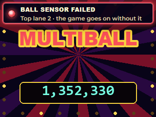

A toast with a red bulb drops in for 4 s and then shrinks into the status bulb. A tap on it opens the [failed device](#failed-device).

### A device works again

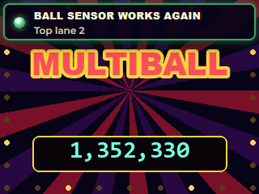

A green toast shows for 3 s. The status bulb goes out when no device is left failed.

## After a game

When the last ball drains, the game enters its post-game phase. A game has up to four players, which the game adds during player 1's first ball. After every game the host asks each player for a name, one after another in player order.

### Game over

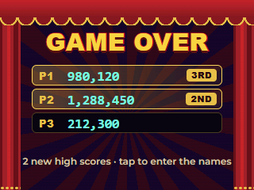

The curtain closes to its edges. The screen lists every player's score and the place of each score that made the game's high-score list. A tap or 3 s open the [name list](#choose-a-name) for player 1. The [keyboard](#name) opens instead while no name is known yet.

### Choose a name

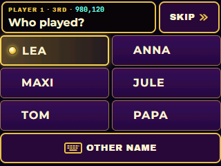

The list offers the six names entered most often across every game. The host counts the names on the card. Without a card it counts them until power-off. The name this player entered after the last game stands first and lit. Top left names the player, the place and the score. A tap on a name enters it. Other name opens the [keyboard](#name). Skip top right leaves without a name. 30 s without a touch do the same. A name or Skip lead to the next player's list. After the last player they lead to the [high scores](#high-scores).

### Name

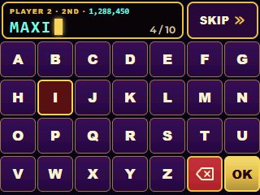

The name has up to 10 letters from A to Z on 44 px keys, 7 across. The keys stand 2 px apart, which is the one place below the 4 px rule, since 7 keys of 44 px fill the 320 px. Top left names the player, the place and the score. The field opens empty. Delete removes the last letter. Skip top right leaves without a name. 30 s without a touch do the same. OK or Skip lead to the next player's [name list](#choose-a-name). After the last player they lead to the [high scores](#high-scores).

### High scores

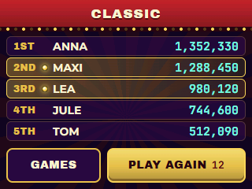

The game's list holds five places. Every new entry is lit. A placed score whose name was skipped stands as `???`. When no score made the list, the players' names and scores stand below the table. Play again or the countdown of 15 s close the [curtain](#curtain) and start the same game. Games closes the curtain and opens on the [game choice](#games).

The host keeps each game's list in `/games/<id>/highscores.yml`, as [saved data](game-abstraction.md#saved-data) gives.

## Sound and lights

Both pages open from the menu in a game and from Settings. A change applies at once and is saved when the page closes. The menu's value is the main control. A game plays within it: the volume or brightness that results is the menu's value times the game's value, as [sounds](components/sounds.md#volume) and [lamps](components/lamps.md#brightness) give.

### Sound

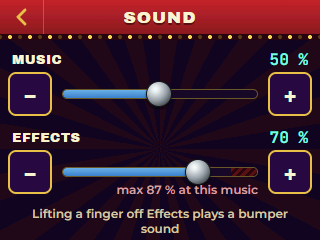

The page sets music and effects. The hatched end of the effects slider shows how far effects may go at the music's setting, since both volumes squared stay at most 1. Back returns to where the page was opened.

### Lights

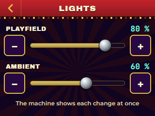

The page sets the playfield brightness and the ambient brightness. The lamps show every step at once. Back returns to where the page was opened.

## Machine and service

The warning lights show one bulb per device of the [device monitor](error-handling.md#device-faults). A bulb is red for a failed device and green for one that works. The amber bulb counts the warnings in the log.

### Warning lights

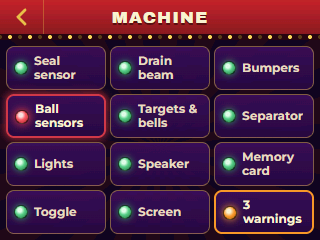

Twelve tiles stand three across. A failed device glows red. A tap on a device opens the [failed device](#failed-device). A tap on the warnings opens the [warnings](#warnings). Back returns to where the page was opened.

### Failed device

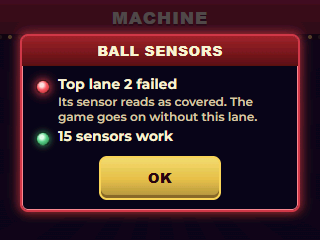

The page names the part that failed, what that means for play and how many parts still work. OK returns to the [warning lights](#warning-lights).

### Warnings

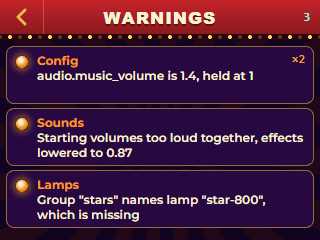

The list holds the logger's warnings since start. Equal lines are counted. It scrolls. Back returns to the [warning lights](#warning-lights).

### Service

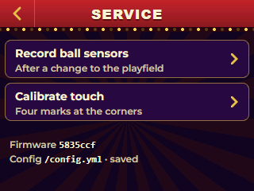

The page holds steps for the operator and opens only from Settings. Below them stand the firmware build and the config file. Back returns to [Settings](#settings).

### Record ball sensors

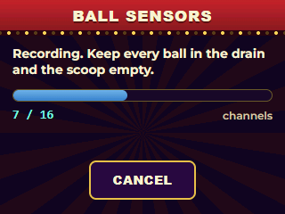

The page runs the recording of the IR sensors from the screen and shows its progress per channel. Done or Cancel return to [Service](#service).

### Calibrate touch

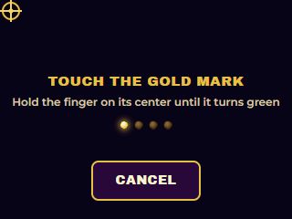

Four gold marks, one per corner, give the four values `touch.raw_*` of the [touch driver's config](drivers/touch.md#config). For this the touch driver reports raw readings. The fourth mark or Cancel return to [Service](#service).
