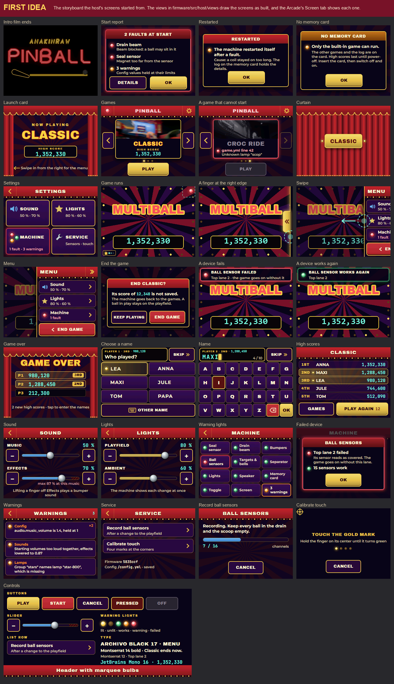

# Host screens

The host's screens let the player choose a game, set sound and lights, and see what the machine reports. They take their colors from the cabinet, from the PINBALL logo and from the diorama screen in the boot film, so the display reads as part of the machine. Every screen is drawn at the display's 320 × 240 pixels in RGB565. The screen component's [host layer](components/screen.md) holds them in front of the game's layers.

The views in [`firmware/src/host/views/`](../../firmware/src/host/views/) draw the screens as built, and the Arcade's Screen tab shows each one with made-up data and leads from screen to screen as the host does. The storyboard below was the first idea they started from.

## Look

### Colors

| Name | Hex | Use | Taken from |
|---|---|---|---|
| night | `#0e061a` | Background of every host screen | Boot film, background of the diorama screen |
| velvet | `#2c0a46` | Tiles, list rows, the second ray | Boot film, violet ray of the diorama screen |
| ray | `#781228` | First ray of the sunburst | Boot film, crimson ray of the diorama screen |
| frame | `#c8242f` | Header band, dialog strip, curtain | [`dio-frame.svg`](../../assets/playfield/parts/dio-frame.svg) |
| cabinet | `#b3242d` | Button fill | [`cabinet.svg`](../../assets/playfield/parts/cabinet.svg), the walls |
| shadow | `#5e1016` | Button edge, pressed button | [`cabinet.svg`](../../assets/playfield/parts/cabinet.svg), the shadow |
| gold | `#e8c04a` | Rims, icons, primary button | Logo, the flipper's gold line |
| bulb | `#ffd65a` | Lit marquee bulb, selection | Boot film, lit bulb of the diorama screen |
| bulb off | `#5a3c1e` | Unlit marquee bulb | Boot film, unlit bulb of the diorama screen |
| cream | `#fff4d6` | Text | Logo, cream |
| cyan | `#78ffe6` | Numbers: score, percent, counts | Boot film, score digits of the diorama screen |
| ramp | `#3d82cf` | Sound slider fill | [`ramp-blue.svg`](../../assets/playfield/parts/ramp-blue.svg) |
| board | `#e2c76b` | Light slider fill, star icon | [`cabinet.svg`](../../assets/playfield/parts/cabinet.svg), the playfield board |
| green | `#3fa66b` | Warning light: works | [`cover-left.svg`](../../assets/playfield/parts/cover-left.svg) |
| neon | `#d63a48` | Warning light: failed, fault rim | Logo, the PINBALL neon |
| amber | `#ff9a2e` | Warning light: warning | Chosen to stand apart from gold and red |

### Controls

- **A touch target is at least 44 × 44 px**, about the size of a fingertip. Buttons and rows stand at least 4 px apart.
- **A button** is a plaque with a gold rim, as the score box on the film's diorama screen. Red is the normal button, gold the one the page is for, and violet the way out. A pressed plaque sinks to the shadow red.
- **The header** is the diorama frame's red band over a strip of marquee bulbs. Back sits top left. The gear and the menu's close sit top right.
- **A slider** has a violet track and a steel ball as its knob. Its fill is ramp blue for sound and board gold for light. A minus and a plus stand beside it, each a step of 5 %.
- **A warning light** is a marquee bulb: green for a device that works, amber for a warning and red for a failed device. A failed device also turns its frame neon red, as the PINBALL tubes.
- **A dialog** is a night card with the red title strip. It dims the screen behind it, and only its buttons take a touch while it shows. A fault dialog glows neon red.
- **Type** is English. Archivo Black sets titles and buttons, as the film's MULTIBALL. Montserrat SemiBold sets text at 14 px and never below 12 px, and Montserrat Bold sets a line in bold. JetBrains Mono Bold sets numbers in cyan, as the film's score. Archivo Black, Montserrat and JetBrains Mono are free fonts under the SIL Open Font License. `lv_font_conv` converts them for LVGL.
- **Motion** stays short. The menu follows the finger in from the right edge and snaps open or back in 150 ms. A finger at the right edge fades the menu's hint in within 150 ms, lets it stand 1 s and fades it in 300 ms. Pages slide sideways in 150 ms. The curtain closes in 250 ms, holds 200 ms and opens in 300 ms. Toasts drop in from the top in 200 ms and stay 4 s for a failed device and 3 s for one that works again.
- **The background** is the film's sunburst, which turns slowly as in the boot film. A switch in Settings stops it. The host saves the choice, and the sunburst turns at first.
- **A list that scrolls** shows no scroll bar. A night fade with a gold arrow at its foot shows that more lies below, and one at its top that more lies above.

## Decisions

The host's menu opens only during a game. On the host's pages the [right edge](components/screen.md#touch) belongs to the page.

Sound and lights each run over their full range. The [sounds component](components/sounds.md#volume) keeps music and effects from overdriving the output.

The larger lights adapter is chosen in Service only after a warning, since a smaller adapter switches off or runs hot under the brighter lights. The [lighting driver](drivers/lighting.md#adapter-profile) takes the choice at the next start.

Ball sensors are recorded again one at a time. A sensor's readings depend on its place in the order the [IR sensing driver](drivers/ir-sensing.md#build-step) reads them, so a recording that moves another sensor marks that one to be recorded again.
