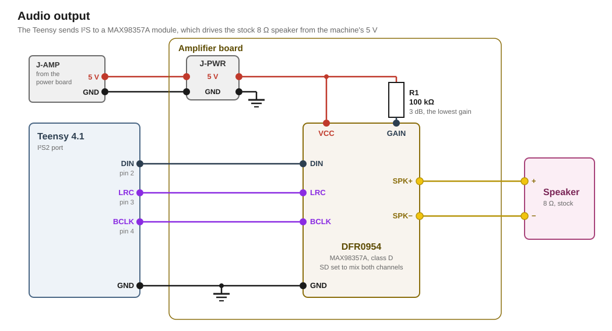

# Audio

The audio subsystem plays the background music and the sound effects through the stock machine's speaker. A DFRobot DFR0954 amplifier module takes the sound from the Teensy as digital data and drives the speaker.

## Requirements

- The stock 8 Ω speaker is reused and the speaker never gets more power than it is rated for.
- Multiple sounds can be played simultaneously
- Sounds can be stored on the SD card
- A sound's volume can be adjusted but must not overdrive the speaker

## DFR0954

The DFR0954 carries a MAX98357A class D amplifier with a built-in DAC. It takes the sound as digital audio over I²S.

The amplifier drives one speaker. I²S always sends two channels. The module plays the left channel, as its schematic shows. The firmware sends the same signal on both channels, so the speaker gets it at full level whichever channel the module plays.

## Circuit

The DFR0954 sits in socket headers on the [Teensy motherboard](../motherboard/design.md), beside the Teensy. R4 sits on the motherboard as well.



### Signal

The Teensy's I²S2 port drives the module over three lines: DIN, the sample data, from pin [2](../../pin-assignment.md "DIN to the DFR0954"), LRC, the frame clock that tells left from right, from pin [3](../../pin-assignment.md "LRC to the DFR0954"), and BCLK, the bit clock, from pin [4](../../pin-assignment.md "BCLK to the DFR0954").

The speaker connects to the module's two outputs, SPK+ and SPK−. 

### Level

The amplifier's GAIN pin sets how strongly it amplifies. R4 between GAIN and VCC picks the weakest amplification. Left open, GAIN would give the small stock speaker too much power.

The speaker carries no marking. Its size suggests a rating of 0.5 W to 1 W. The driver keeps the overall volume low enough that even the loudest sound gives it at most 0.5 W. [Speaker level](#speaker-level) derives that volume from the amplifier's datasheet and the speaker's resistance. A firmware bug could still turn the volume all the way up. R4 then still keeps the speaker under 1 W.

### Supply

The module takes the machine's 5 V from the motherboard's J-MB-PWR ahead of [D1](../motherboard/design.md#supply) and decouples its own supply pin. It therefore stays off while the Teensy runs on USB alone. Capped at 0.5 W, it draws at most 129 mA.

A 3.3 V supply from the Teensy was rejected, because the other subsystems already take nearly all of its 3V3 pin.

The Teensy drives the module's inputs directly, and the module's 5 V never reaches a Teensy pin.

## Firmware

[`docs/firmware/drivers/audio.md`](../../firmware/drivers/audio.md) describes the driver.

## Part list

| Qty | Part | Where |
|---|---|---|
| 1 | DFRobot DFR0954, MAX98357A amplifier module | in socket headers on the Teensy motherboard, between the Teensy and the speaker |
| 1 | 100 kΩ resistor, 5 % or better | R4, on the motherboard from GAIN to VCC |
## Appendix: derivations

Every figure below is recomputed by [`figures.py`](figures.py) from the inputs it names, and `tools/figcheck.py` compares each one against the line that states it.

### Speaker level

```
LEVEL     the DAC's full scale, in dB above
          one volt rms                             2.1 dB
          the gain GAIN selects through 100 kΩ
          to VCC                                   3 dB
          a full-scale sine at the speaker       = 1.80 V
          the speaker                              8 Ω
          that sine into it                      = 0.40 W
          a full-scale square wave, twice that   = 0.81 W
          the power the speaker is assumed to
          take                                     0.5 W
          the master gain that holds the square
          wave to it                             = 0.786
```

### Digital inputs

```
INPUTS    the Teensy's high level                  3.3 V
          where the amplifier's inputs switch      1.3 V
          what they are rated to, powered or not   6 V
          GAIN through R4, at most               = 4.25 V
```

### Supply

```
SUPPLY    the machine's rail                       5 V
          the peak of a full-scale signal        = 2.54 V
          the amplifier idling, at most            3.35 mA
          its efficiency at the capped output,
          assumed                                  80 %
          the capped output drawn from the rail,
          at most                                = 129 mA
```

### Audio stream

```
STREAM    the Audio library's sample rate          44.1 kHz
          its block                                128 samples
          one block, the period of its update    = 2.90 ms
          the bits AudioOutputI2S2 clocks per
          frame                                    64 bits
          the bit clock that makes               = 2.82 MHz
          the amplifier's bit clock, from          0.2432 MHz
          up to                                    25.804 MHz
```

### Stream buffers

```
BUFFERS   RAM2 on the Teensy 4.1                   512 KB
          the ring buffer of each channel          32 KB
          the chunk the card is read in            4 KB
          one mono 16-bit sample                   2 bytes
          what a channel holds ahead at least    = 325 ms
          the longest one card read may take
          with all four channels waiting         = 81.2 ms
          all four channels together             = 128 KB
```

## Sources

- [`research/Rokr/5_sound.md`](../../research/Rokr/5_sound.md): the stock speaker, its impedance and the estimate of its rating, and the stock sounds
- [`datasheets/MAX98357A-MAX98357B-Maxim.pdf`](../../datasheets/MAX98357A-MAX98357B-Maxim.pdf): the gain steps, the full-scale output, the input levels and ratings, and the interference measurement with 30 cm of speaker cable
- [`datasheets/DFR0954-DFRobot-schematic.pdf`](../../datasheets/DFR0954-DFRobot-schematic.pdf): the module's own parts and the channel it plays
- [DFRobot wiki, DFR0954](https://wiki.dfrobot.com/SKU_DFR0954_MAX98357_I2S_Amplifier_Module): what the module's GAIN pin selects
- [`pin-assignment.md`](../../pin-assignment.md): the I²S2 pins
