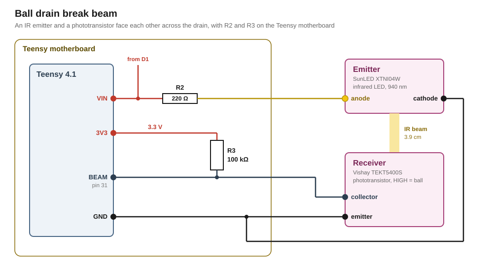

# Break beam at the ball drain

A break-beam gate across the drain reports the ball leaving play. Its emitter is a SunLED XTNI04W infrared LED. Its receiver is a Vishay TEKT5400S phototransistor with a daylight filter.

## Circuit

R2 and R3 sit on the [Teensy motherboard](../motherboard/design.md).



### Signal

Pin [31](../../pin-assignment.md "Receiver output of the ball drain gate") reads HIGH while a ball blocks the beam and LOW while the beam is clear. The receiver sits between the pin and GND and conducts while it is lit. Without light, R3 with 100 kΩ pulls the pin up to the Teensy's 3V3.

The weakest receiver still pulls 2.7× the current a LOW needs. For a HIGH, the ball has to bring the receiver's current below 8.2 µA.

The Teensy's internal pull-up stays off, since together with R3 it would prevent the pin from reading LOW. A broken cable or a dead emitter leaves the pin HIGH. The driver then reports the beam failed after 5 s.

### Supply

R2 with 220 Ω feeds the emitter from the supply behind [D1](../motherboard/design.md#supply). The Teensy's VIN sits on the same node. The emitter therefore also runs while the Teensy is on USB alone. The emitter carries 10.8 to 25.2 mA across the node's voltage range.

## Teensy pins

The receiver's output puts no requirements on its pin.

[`pin-assignment.md`](../../pin-assignment.md) lists what the pin costs elsewhere in the build.

## Firmware

A driver interrupts when a ball breaks the IR beam and publishes it to the [event queue](../../firmware/input-handling.md). [`docs/firmware/drivers/break-beam.md`](../../firmware/drivers/break-beam.md) describes the driver.

## Mounting

The emitter and the receiver sit 3.9 cm apart in the stock machine's niches on either side of the drain.

## Part list

| Qty | Part | Where |
|---|---|---|
| 1 | SunLED XTNI04W, side-looking infrared LED, 940 nm | the emitter, in one niche |
| 1 | Vishay TEKT5400S, side-looking phototransistor with daylight filter | the receiver, in the opposite niche |
| 1 | 220 Ω resistor, 0.25 W, 5 % | R2, on the motherboard, from the supply behind D1 to the emitter |
| 1 | 100 kΩ resistor, 5 % | R3, on the motherboard, from 3V3 to pin [31](../../pin-assignment.md "Receiver output of the ball drain gate") |

## Appendix: derivations

[`figures.py`](figures.py) recomputes every figure below from its inputs, and `tools/figcheck.py` checks each one against its line.

### Emitter

```
EMITTER   VIN at 6 A, at least                   = 4.11 V
          the emitter's forward voltage at 20 mA,
          at most                                  1.6 V
          across R2, at least                    = 2.51 V
          R2                                       220 Ω
          its tolerance                            5 %
          R2 at its most                         = 231 Ω
          the emitter's current, at least        = 10.8 mA
          VIN from the adapter or USB, at most     5.25 V
          R2 at its least                        = 209 Ω
          the emitter's current with no forward
          voltage left, at most                  = 25.2 mA
          the ambient the build assumes            40 °C
          what the emitter's derating allows
          there                                  = 40 mA
RATINGS   R2's power, at most                    = 132 mW
          its rating                              0.25 W
          the emitter's power, at most           = 33 mW
          what the emitter allows                  90 mW
```

### Receiver

```
LIT       the emitter's intensity at 20 mA, at
          least                                    2 mW/sr
          at its least current                   = 1.08 mW/sr
          the gap between the two niches           3.9 cm
          the irradiance at the receiver, at
          least                                  = 0.071 mW/cm²
          the receiver's light current at
          1 mW/cm² and 5 V, at least               2 mA
          and typically                            4 mA
          its sensitivity at the emitter's
          940 nm, Figure 7                         89 %
          at the 950 nm the current is given at    80 %
          Figure 4 at 1 V, typically, at
          0.1 mW/cm²                               0.21 mA
          and at 0.2 mW/cm²                        0.53 mA
          the light current at the irradiance
          above and 1 V, at least                = 0.067 mA
LOW       the Teensy's 3V3                         3.3 V
          its accuracy                             1 %
          3V3 at its most                        = 3.333 V
          the LOW threshold there                = 1.00 V
          what R3 has to drop for a LOW          = 2.34 V
          R3                                       100 kΩ
          R3 at its least                        = 95 kΩ
          the light current's drop across it     = 6.37 V
          the margin                             = 2.7×
BLOCKED   the receiver's dark current, at most     100 nA
          the pin's input current, at most         1 µA
          R3 at its most                         = 105 kΩ
          what both drop across it               = 0.116 V
          3V3 at its least                       = 3.267 V
          the HIGH threshold there               = 2.287 V
          what R3 may drop for a HIGH            = 0.98 V
          what the receiver may carry with the
          ball in the beam, at most              = 8.2 µA
          R3's current from 3V3, at most         = 35.1 µA
```

### Ball

```
BALL      the steel ball                           9 mm
          the fastest ball the build assumes       3 m/s
          how long it blocks the beam            = 3 ms
```

## Sources

- [`datasheets/XTNI04W-SunLED.pdf`](../../datasheets/XTNI04W-SunLED.pdf), XDSA2670 V8-X: the forward voltage and the radiant intensity at 20 mA, the intensity's rise with the current, the ratings and the derating curve
- [`datasheets/TEKT5400S-Vishay.pdf`](../../datasheets/TEKT5400S-Vishay.pdf), 81569 Rev. 1.6: the light current and its curves, the dark current, the spectral sensitivity, the daylight filter and the load the switching times are given at
- [`datasheets/IMXRT1060CEC.pdf`](../../datasheets/IMXRT1060CEC.pdf), Rev. 4: Table 22, the input thresholds and the input current
- [PJRC, Teensy 4.1](https://www.pjrc.com/store/teensy41.html): every digital pin detects changes with `attachInterrupt`
- [`research/teensy-4.1.md`](../../research/teensy-4.1.md): the 3.3 V rail and its accuracy
- [`parts/power/design.md`](../power/design.md): VIN's range from the adapter and on USB alone
- [`parts/ir-reflective/design.md`](../ir-reflective/design.md): the ball, the fastest ball and the ambient the build assumes
- [`pin-assignment.md`](../../pin-assignment.md): which pins were free, and what pin [31](../../pin-assignment.md "Receiver output of the ball drain gate") costs
