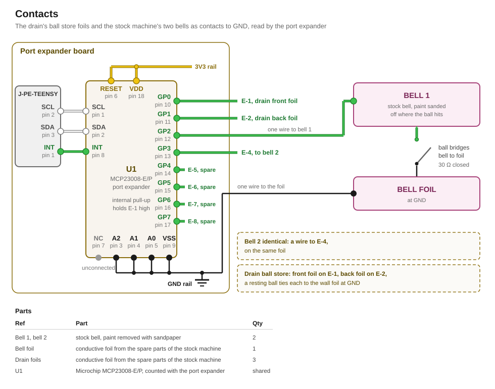

# Contacts

A contact closes an input of the port expander to GND while a ball touches it. The drain's ball store and the playfield's hit targets are built from such contacts.

## Drain ball store

The ball store in the [drain](../../firmware/components/drain.md#ball-store) holds up to two balls in front of the seesaw. Three conductive foils from the spare parts of the stock machine sense them.

| Foil | Lies | Wired to |
|---|---|---|
| front | on the track floor between the seesaw's two fingers, which stand 9 mm apart | E-1 of the port expander |
| back | on the track floor behind the rear finger, up to the store's entry | E-2 of the port expander |
| wall | on the track's side wall, along both places | the GND rail of the [Teensy motherboard](../motherboard/design.md) |

The rear finger's slot through the track separates the front foil from the back foil.

A stored ball rests on a floor foil and leans against the wall foil. It thereby ties that floor foil to GND. The track has to hold every ball in the store against the side wall, because a ball off the wall closes nothing.

A ball touches the floor in a single point. It therefore never closes both floor foils at once, and one ball never reads as two. Two balls that touch each other change no reading, because each of them already ties its floor foil to the wall foil at GND.

## Hit targets

A hit target is a contact that the ball closes when it hits the target.

### Bells

The stock machine has two bells. To reuse them as hit targets, each bell needs to form a contact with a conductive foil at GND. A ball that hits a bell touches the foil and the bell at once. The bell then sits at GND.

The bells therefore need to have their paint removed with sandpaper, so the ball meets bare metal there. The foil comes from the spare parts of the stock machine and is glued onto the playfield. Because of the targets' design, this foil must not touch the bumper foil.

Bell 1 is wired to the input E-3 of the port expander and bell 2 to E-4. The foil is wired to the GND rail of the [Teensy motherboard](../motherboard/design.md).

### Stand-up targets

> [!TODO]

## Circuit



### Signal

Each floor foil of the ball store and each hit target closes an input of the [port expander](../port-expander/design.md) U1 to GND. U1's internal pull-up holds an open input high. A closed contact pulls its input under U1's low threshold.

U1 copies its inputs at every change, so a closure reaches the Teensy however short it is.

## Firmware

The [contact driver](../../firmware/drivers/contacts.md) publishes each closure as `ContactClosed`. The ball store's foils are sources `0` and `1`, which the [drain component](../../firmware/components/drain.md) reads. The bells are sources `2` and `3`.

## Part list

| Qty | Part | Where |
|---|---|---|
| 2 | stock bell, paint removed with sandpaper | bell 1 on E-3, bell 2 on E-4 |
| 1 | conductive foil from the spare parts of the stock machine | glued onto the playfield under the bells, wired to the GND rail |
| 3 | conductive foil from the spare parts of the stock machine | glued into the ball store, the front foil on E-1, the back foil on E-2, the wall foil wired to the GND rail |
| shared | Microchip MCP23008-E/P | U1, listed and counted in the [port expander](../port-expander/design.md#part-list) |

## Appendix: derivations

[`figures.py`](figures.py) recomputes every figure below from its inputs, and `tools/figcheck.py` compares each one against the line that states it.

### Levels

```
LEVELS    U1's weak pull-up current, at most       115 µA
          the ball's contact, as at a shell        30 Ω
          a touched bell's input, at most        = 3.5 mV
          the 3V3 rail, at least                   3.267 V
          U1's low threshold, of the rail          20 %
          that threshold, at least               = 0.65 V
          the ball's contact, at most            = 5.68 kΩ
```

### Drain ball store

```
STORE     a stored ball's floor foil and wall
          foil in series                         = 60 Ω
          a stored ball's input, at most         = 6.9 mV
```

## Sources

- [`datasheets/MCP23008-MCP23S08-Microchip.pdf`](../../datasheets/MCP23008-MCP23S08-Microchip.pdf), DS20001919F: the low threshold D031 and the pull-up current D070
- [`parts/solenoid/design.md`](../solenoid/design.md#sense): the ball's measured contact between foil and shell
- [`parts/port-expander/design.md`](../port-expander/design.md): U1 and its inputs
- [`research/teensy-4.1.md`](../../research/teensy-4.1.md): the 3V3 rail
