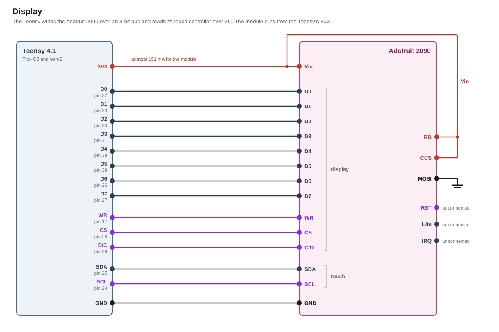

# Display

## Use cases

The display can be used to show various things such as:

- The player changes the game and machine settings on the display by touch.
- The host shows device faults and debug values on the display, also over a running game.
- A game shows videos from the SD card in a part of the screen or over the whole screen, with or without its own drawings in front.
- A full-screen movie plays at 25 frames a second while the sounds keep playing.

## Hardware

This modification uses an Adafruit 2090 2.8" capacitive touch display. The panel uses an ILI9341 controller. It takes commands and pixels over an 8-bit bus. Eight data lines carry one byte at a time. The display takes the byte when the write line WR goes high. D/C tells whether the byte is a command or the data that follows one. The display listens only while CS is low. A pixel takes two bytes of RGB565, high byte first.

The touch controller is a CST026 at the I²C address 0x38.

## Installation & Mounting

The module measures 81.3 mm by 62.5 mm. A printed frame holds the module by its four holes of 3 mm. The holes sit 76.2 mm by 57.2 mm apart. The module gets screwed into the diorama's background plate. The screen faces the player in landscape. 

The part B20 from the stock machine either needs to be cut, removed or replicated with a different motif to not cover parts of the screen.

## Circuit

A display board beside the module carries J-DISP-PWR and the Adafruit 757 as a daughter board. J-DISP-PWR takes 5 V and GND from the power board's J-DISP. The touch cable from the Teensy ends on the board. Vin, RD, GND, SDA and SCL run from the board to the module's 8-bit header. Vin and RD both carry the board's 5 V. The bus and its ground run from the Teensy straight to the same header.



### Bus

The data lines D0 to D7 run from pins [22](../../pin-assignment.md "D0 to the display"), [23](../../pin-assignment.md "D1 to the display"), [20](../../pin-assignment.md "D2 to the display"), [21](../../pin-assignment.md "D3 to the display"), [38](../../pin-assignment.md "D4 to the display"), [39](../../pin-assignment.md "D5 to the display"), [26](../../pin-assignment.md "D6 to the display") and [27](../../pin-assignment.md "D7 to the display"). 

FlexIO3 is a programmable I/O block of the i.MX RT. FlexIO3's timer drives WR on pin [17](../../pin-assignment.md "WR to the display") and puts one byte on the data lines with each strobe. CS on pin [28](../../pin-assignment.md "CS to the display controller") and D/C on pin [29](../../pin-assignment.md "D/C to the display") are plain digital outputs.

The driver sets the bus pins to their weakest drive and their slow slew rate. WR then rises too gently to ring, so the display takes each byte exactly once. That edge is still fast enough for FlexIO3's clock.

The display only receives, so RD is held at 5 V over its own wire from the display board. CCS is tied to 3.3Vout, which keeps the module's card socket off. MOSI is tied to GND at pin 1 of the SPI header. RST, Lite and the touch controller's IRQ stay unconnected.

IM0 to IM3, MISO and CD stay unconnected as well. The module's jumpers set the 8-bit mode. Pins named alike on both headers are one line on the module. On the SPI header, CLK carries C/D and D/C carries WR. These two and that header's CS stay open.

### Touch

The touch controller sits on `Wire2`, with SDA on pin [25](../../pin-assignment.md "SDA to the touch controller") and SCL on pin [24](../../pin-assignment.md "SCL to the touch controller"). The bus runs at the Standard-mode rate of 100 kHz.

Between the Teensy and the module both lines pass an Adafruit 757, a converter with a BSS138 and a 10 kΩ pull-up per line on each side. Its LV side takes the Teensy's 3.3 V over a third wire of the touch cable, its HV side the board's 5 V. The Teensy's pins therefore see only their own rail. Without the Teensy's 3.3 V the transistors are off, and their body diodes block toward the Teensy, so nothing reaches a Teensy that is off. On the module R13 and R14 pull the HV side to Vin as well.

### Reset

After power-up, the module holds the panel and the touch controller in reset for up to 280 ms. Until then, both ignore every command. If the module's 3.3 V falls below 3 V during play, the module resets both again. The panel then comes back with its display off. The [display driver](../../firmware/drivers/display.md) then sets it up again. The [screen component](../../firmware/components/screen.md) redraws the picture.

### Supply

The module takes its 5 V from the power board's [J-DISP](../power/design.md#outputs) over the display board and makes its own 3.3 V. The display draws at most 198 mA from J-DISP.

## Teensy pins

| Signal | What the pin has to be |
|---|---|
| D0 to D7 | Eight pins that FlexIO3 numbers in a row, since FlexIO3 puts out a byte on eight such pins at once. FlexIO3's pins 8 to 15 are such a run. No other subsystem needs them |
| WR | A FlexIO3 pin outside that run, which FlexIO3's timer drives. Here FlexIO3's pin 6 |
| CS, D/C | Plain digital outputs |
| SDA, SCL | An I²C port apart from `Wire`. A touch controller that hangs with a line held low then blocks no other device. Sharing `Wire` would save the two pins |

[`pin-assignment.md`](../../pin-assignment.md) lists the pins and what they cost elsewhere in the build.

## Firmware

The [screen component](../../firmware/components/screen.md) draws the picture using LVGL, from three layers that lie on top of each other. From the front, they are the host's layer, the game's layer and the background. The [video player](../../firmware/components/video-player.md) plays a video in a viewport on the background.

The [display driver](../../firmware/drivers/display.md) sends what LVGL draws over FlexIO3. The [touch driver](../../firmware/drivers/touch.md) reads the touch panel.

## Limitations

Fast motion in a video can show a tear, since the module gives no signal when the panel refreshes.

The video rate rests on an estimate of the card's speed. A slower card makes a video stutter before it touches the sound.

## Part list

| Qty | Part | Where |
|---|---|---|
| 1 | Adafruit 2090, 2.8" TFT with capacitive touch, ILI9341 and CST026 | in the diorama |
| 1 | Adafruit 757, bidirectional logic level converter, BSS138 | on the display board, in SDA and SCL between the Teensy and the module |
## Appendix: derivations

Every figure below is recomputed by [`figures.py`](figures.py) from the inputs it names. `tools/figcheck.py` compares each one against the line that states it.

### Bus

```
BUS       the FlexIO3 clock                        120 MHz
          its clocks for one write                 10 clocks
          one write on the bus                   = 83.3 ns
          the ILI9341's write cycle, at least      66 ns
          WR low, then WR high, each             = 41.7 ns
          the ILI9341's WR low and WR high, each
          at least                                 15 ns
          a buffer's delay on the module, from     1.5 ns
          up to                                    6.3 ns
          the skew between WR and the data       = 4.8 ns
          setup and hold at the panel, each at
          least                                  = 36.8 ns
          the ILI9341's setup and hold, each at
          least                                    10 ns
EDGE      a bus pin at its weakest drive, typical  157 Ω
          the cable, at most                       50 cm
          one wire of the cable                    50 pF
          a buffer input on the module             5.5 pF
          an edge between 10 % and 90 %          = 19.2 ns
          that edge per volt of the swing        = 7.33 ns/V
          what the buffers allow, at most          10 ns/V
LEVELS    the Teensy's rail                        3.3 V
          its high, at least                     = 3.11 V
          the buffers' high input level            2 V
          the margin of the high                 = 1.11 V
          the Teensy's low, at most                0.15 V
          the buffers' low input level             0.8 V
          the margin of the low                  = 0.65 V
```

### Picture

```
FRAME     the panel in landscape, pixels across  = 320
          and rows down                          = 240
          one pixel on the bus                     2 bytes
          one frame                              = 150 KB
          that frame on the bus                  = 12.8 ms
          the full screen anew, at most          = 78.1 Hz
          one burst, eight shifters of four
          bytes                                  = 32 bytes
          that burst on the bus                  = 2.67 µs
          the processor's clock                    600 MHz
          its clocks for one refill, estimated     150 clocks
          its share while the bus sends          = 9.4 %
          the clocks one burst gives a refill    = 1600 clocks
          the display's tick, which steps a
          restart                                  40 ms
LVGL      its two buffers of the whole screen in
          RAM2                                   = 300 KB
          its refresh period                       33 ms
          the picture memory, the whole PSRAM    = 8 MB
          the opaque full-screen pictures it
          holds                                  = 54
MOVIE     the frame rate of every movie            25 Hz
          one frame                              = 40 ms
          the chunk the card is read in            16 KB
          a full-screen frame, in chunks         = 9.4
CARD      one 4 KB read, at an estimated 1500 a
          second                                 = 0.667 ms
          the SD bus's High Speed clock            50 MHz
          4 KB on that bus                       = 0.164 ms
          one audio chunk on the Teensy,
          estimated                              = 0.831 ms
          16 KB on that bus                      = 0.655 ms
          one movie chunk on the Teensy,
          estimated                              = 1.33 ms
          a full-screen frame from the card      = 12.4 ms
          the four audio streams meanwhile       = 2.87 ms
          the card's load at 25 frames a second  = 38.2 %
          the same on the A1 class alone, every
          4 KB a random read                     = 85.1 %
```

### Touch bus

```
TOUCH     the bus clock                            100 kHz
          one byte on the bus                      9 bits
          one read, the address, the register,
          the address again and five bytes       = 750 µs
          the touch driver's tick                  20 ms
          its share of the bus at one read a tick= 3.75 %
          the converter's pull-up on SDA and SCL   10 kΩ
          the converter's pull-ups at the Teensy,
          both lines low                         = 0.67 mA
          the BSS138's gate threshold, at most     1.5 V
          each bus line, estimated                 100 pF
          a rising edge between 0.3 and 0.7 of
          the rail                               = 848 ns
          what Standard mode allows                1000 ns
```

### Supply

```
SUPPLY    the power board's rail                   5 V
          VCC, the module regulator's output,
          at most                                = 3.35 V
          each LED's resistor                      10 Ω
          an LED's forward voltage, at least       2.9 V
          one LED, at most                       = 45 mA
          the four LEDs                          = 180 mA
          the ILI9341, assumed                     10 mA
          the touch controller, at most            5 mA
          the module, at most                    = 197 mA
          R12 at RD, from the rail, at most      = 0.53 mA
          the converter's pull-ups at Vin, both
          lines low                              = 1 mA
          J-DISP carries, at most                = 198 mA
          the adapter with no load, at most        5.25 V
          what the regulator dissipates, at most = 0.4 W
          its thermal resistance, SOT25, no
          heatsink                                 184 °C/W
          the air around it                        40 °C
          its junction, at most                  = 113 °C
          its junction rating                      150 °C
          its input, at most                       6 V
          the rail's highest peak                  5.46 V
          the buffers' input at RD, at most        5.5 V
VCC       the regulator's accuracy                 1.5 %
          VCC, at least                          = 3.25 V
          the regulator's dropout at the module's
          current, at most                       = 131 mV
          Vin it needs, at least                 = 3.49 V
          the ILI9341's lowest supply              2.5 V
          the supervisor's threshold, below        3 V
          the ILI9341's highest supply             3.3 V
          VCC above it, at most                  = 50 mV
          the ILI9341's absolute maximum           4.6 V
START     the supervisor's reset after power-up,
          at most                                  280 ms
          the ILI9341, from its reset to its
          first command                            5 ms
          the driver's first command, after
          power-up                               = 285 ms
          the ILI9341, from Sleep Out to running   120 ms
          the touch controller, from its reset to
          its first answer                         300 ms
          the driver's first touch read, after
          power-up                               = 580 ms
```

## Sources

- [`datasheets/ILI9341-Ilitek.pdf`](../../datasheets/ILI9341-Ilitek.pdf), ILI9341_DS_V1.11: the 8080-I write timing in 18.3.1, the absolute maximum in 18.1, the supply range and the input levels in 18.2.1, the reset timing in 15.4, Sleep Out, the RGB565 transfer and the frame memory
- [Adafruit 757, EAGLE files](https://github.com/adafruit/4-Channel-Level-Shifter-PCB), Adafruit FET 4-Channel Shifter.sch: the converter's transistors and pull-ups
- [`datasheets/BSS138-onsemi.pdf`](../../datasheets/BSS138-onsemi.pdf), Rev C: the gate threshold and the drain-source voltage
- [`parts/power/design.md`](../power/design.md): the adapter's no-load maximum, the rail's peak and J-DISP
- [`datasheets/CH280QV10-CT-ChengHao.pdf`](../../datasheets/CH280QV10-CT-ChengHao.pdf), Rev. D: the panel Adafruit names for the 2090, its active area, its four backlight LEDs and their forward voltage, and the CST026 as its touch controller
- [Adafruit, 2090 product page](https://www.adafruit.com/product/2090): the module's size, its holes and weight, and the CST026
- [Adafruit, EAGLE files of the 2090](https://github.com/adafruit/Adafruit-2.8-TFT-with-Capacitive-Touch-PCB), rev D: the buffers and their direction, the pull-ups on RD, SDA, SCL and Lite, the backlight's resistors, the supervisor and the unconnected TE
- [Adafruit, 2.8" and 3.2" Color TFT Touchscreen Breakout v2](https://cdn-learn.adafruit.com/downloads/pdf/adafruit-2-8-and-3-2-color-tft-touchscreen-breakout-v2.pdf): Vin from 3 V, the touch controller's address
- [`datasheets/SN74LVC245A-TI.pdf`](../../datasheets/SN74LVC245A-TI.pdf), SCAS218X: the input levels, the transition rate, the input capacitance and the delay, standing for the module's 74LVC245
- [`datasheets/AP2112-Diodes.pdf`](../../datasheets/AP2112-Diodes.pdf), DS39724: the dropout, the output current, the accuracy, the input range and the thermal resistance
- [`datasheets/APX803-Diodes.pdf`](../../datasheets/APX803-Diodes.pdf), DS32131: the reset timeout, the threshold variants and their hysteresis
- [`datasheets/CST026-Hynitron.pdf`](../../datasheets/CST026-Hynitron.pdf): the touch controller's supply current and its I²C clock
- [FocalTech, FT6x06 datasheet](https://cdn-shop.adafruit.com/datasheets/FT6x06%20Datasheet_V0.1_Preliminary_20120723.pdf), V0.1: the time from reset to the first I²C answer
- [`datasheets/IMXRT1060CEC.pdf`](../../datasheets/IMXRT1060CEC.pdf), Rev. 4: Table 27, the pads' drive strengths
- [i.MX RT1060 reference manual](https://www.pjrc.com/teensy/IMXRT1060RM_rev3.pdf), Rev. 3: Table 14-5, the FlexIO clock's limit; 50.3.3.1, the shifters that drive several pins; Table 4-3, no DMA request for FlexIO3
- [SD Specifications Part 1, Physical Layer Simplified Specification](https://www.sdcard.org/downloads/pls/), version 6.00: the A1 class in 4.16, the source of the estimated read rate, and its clocks in Table 4-72
- [`datasheets/UM10204-NXP.pdf`](../../datasheets/UM10204-NXP.pdf): the Standard-mode rise time
- [`research/teensy-4.1.md`](../../research/teensy-4.1.md): the pins are not 5 V tolerant
- [`pin-assignment.md`](../../pin-assignment.md): the display's pins and their cost
