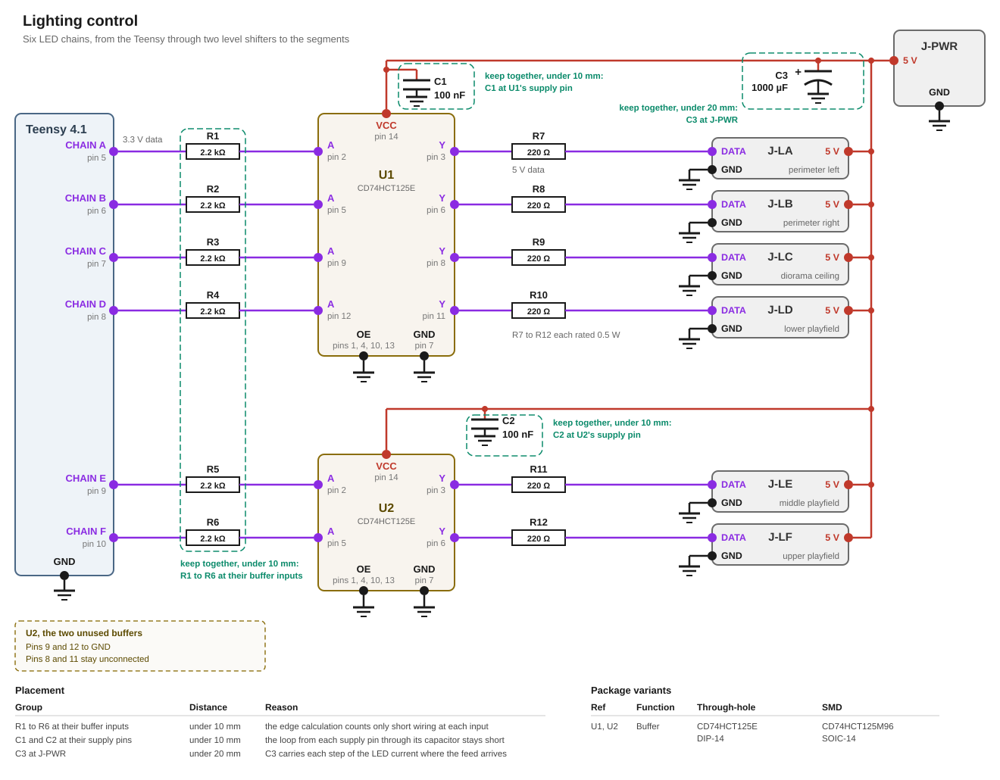

# Lighting

Every light of the modification is an RGB LED whose color is set separately. The Teensy drives the lights on multiple chains through level shifters.

## Stock lighting

The stock lights are single-colored, soldered to the mainboards or switched only in groups, so none of them can be reused. [`research/Rokr/4_lighting.md`](../../research/Rokr/4_lighting.md) lists them.

## LEDs

The modification keeps the stock light positions but also adds new lights for game mechanics. 

Most lights come from a cuttable strip of WS2812B LEDs, 2 m long and 2.7 mm wide. This format also barely fits the stock plastic trenches along the playfield's side panels. A WS2812B is an RGB LED with its own controller. It takes its color from a data line and passes the remaining data on to the next LED, so the LEDs on one data line form a chain. A segment is a piece cut from the strip and fitted at one place. The segments of a chain are wired one after the other.

The sides and the diorama ceiling take 115.5 cm of the strip and the other stock positions about 45 cm.

The ball count board P28 is taken out whole and kept intact. Six LEDs take its positions.

## Light layout

Positions follow the stock inventory in [`research/Rokr/4_lighting.md`](../../research/Rokr/4_lighting.md), with the three stock strips replaced by strips with 160 LEDs/m.

Due to power saving, the perimeter may [light only every second LED](#current-ceiling). The table below lists all LEDs currently planned in the project.

| Location | Chain | LEDs | Lit |
|---|---|---|---|
| Perimeter left | A | 79 | 40 |
| Perimeter right | B | 79 | 40 |
| Diorama ceiling | C | 26 | 26 |
| Playfield score stars | D | 10 | 10 |
| Drain | D | 1 | 1 |
| Shooter Lane Lights (stock: P28) | D | 6 | 6 |
| Track Arrows | E | 4 | 4 |
| Track Lights* | E | 3 | 3 |
| Scoop* | E | 1 | 1 |
| Targets* | E | 4 | 4 |
| Bumper section | F | 4 | 4 |
| Top lane rollovers* | F | 3 | 3 |
| Playfield action lights* | D - F | 20 | 20 |
| **Total** |  | **240** | **162** |

**New in this machine*

The LEDs are organized in chains by where they sit and by how the game uses them. There are two kinds:

1. Playfield lights are single lights that stand for something in the game, such as a bumper or a score star. A component switches each of them. They share chains by location, which keeps the chains and their wiring short.
2. Ambient lights along the perimeter and in the ceiling act as strips. Effects run along a strip as a whole, so the game never needs to know which LED is which. Each strip forms a chain, since the three together hold 184 of the 240 LEDs.

Chains A to C are the three ambient strips. Chain D covers the lower playfield, chain E the middle and chain F the upper playfield.

The new lights without a chain get one once their positions are fixed.

The locations of the **playfield action lights** are not yet decided. Their amount is estimated to plan for reserve. 

> [!TODO]
> Picture of the playfield with new light positions.

## Mounting

Each new playfield light sits in a hole drilled through the playfield. The hole is 6 to 10 mm wide, depending on the position. A 3D-printed diffuser plugs the hole, as in the stock machine, and the LED sits inside it. A light that stays out of sight needs no plug and a much smaller hole.

The perimeter segments lie in the transparent trenches along the side panels, like the stock strips. The ceiling segment is glued to the diorama ceiling, like the stock strip.

## Current ceiling

> [!TODO]
> Measure the strip's current per color and set FastLED's power model to it. Until then the cap lets more current through than it states.

At full white, the 162 lit LEDs would draw 9.72 A, with red, green and blue at about 20 mA each. The controller in each LED adds about 1 mA even while the LED is dark, 0.24 A for all 240. The supply cannot deliver that.

This machine is designed for power supplies which deliver 3 to 6 A. The [power design](../power/design.md#adapter) reserves 0.91 A for the permanent consumers, the Teensy with its SD card, the audio, the display and the IR mainboard. Not counting solenoids here, that leaves at least 2.09 A for the lighting.

The firmware caps the lighting at 2 A for a 3 A power supply or at 3.3 A for a 6 A power supply using FastLED's `setMaxPowerInVoltsAndMilliamps` function. FastLED then dims every light before each `show()` until the sum fits the set max current.

The perimeters may light only every second LED, which halves their current at full white from 9.5 A to 4.8 A. The perimeters and the ceiling also never run at full brightness.

## Circuit

The lighting runs on two identical boards. The ambient board drives chains A to C, the perimeters and the ceiling. The playfield board drives chains D to F.

### Level shifting

A Teensy pin outputs only 3.3 V. The LED chain needs at least 3.5 V for a high bit, so the data lines need level shifting to 5 V.

**One CD74HCT125E** on each board shifts the data lines to 5 V. It has four channels. Its inputs accept 3.3 V as a valid high. Three of the channels carry the board's chains.

| Connection | Requirement |
|---|---|
| VCC, pin 14 | 5 V. The part is specified from 4.5 to 5.5 V and has no 3.3 V operating range |
| Decoupling | C1, 100 nF between pin 14 and pin 7, under 10 mm from pin 14 |
| OE, pins 1, 4, 10, 13 | All to ground. OE is active low, and an open OE leaves the output in high impedance |
| Used inputs | 2.2 kΩ from the Teensy pin to each, under 10 mm from the input. Each input has a clamp diode to VCC. With the machine off and the Teensy on USB, the resistor holds the pin's current into it to 1.6 mA |
| Unused inputs | To ground |

For the LEDs to read a high bit, each buffer has to put out at least 3.5 V. The buffer puts out at least 3.7 V.

The 2.2 kΩ resistors that protect the Teensy pins also slow the data edges slightly, but the signal still reaches the LEDs well inside their timing.

### Signal wiring

**A series resistor sits in each data line** at the buffer's output. On a long cable it damps the ringing a steep edge would cause. If a data wire touches 5 V or ground, the 330 Ω resistor also limits the output's current to 18 mA, inside the 35 mA the output is rated for. It then carries under half of the 0.25 W the resistor kit rates it. The value lies above the 47 to 220 Ω PJRC names as probably best for matching the wire. With the wire and the first LED's input estimated at 150 pF, it shortens a high at that LED by 91 ns at most. With the 20 ns the input resistor costs, that stays inside the LED's 150 ns tolerance.

### Supply

Each board takes the machine's 5 V through its own power input, J-AMBIENT-PWR or J-PLAYFIELD-PWR, and passes it on to its three chain outputs, J-LA to J-LC on the ambient board and J-LD to J-LF on the playfield board. The buffer also takes its 5 V at that input. The input is a pair of 22 AWG (better 18 or 16 AWG) wires, at most 30 cm long and **soldered** at both ends. The board's ground comes over that pair from the power board's star point, so no ground wire runs from the Teensy.

> On the bench, with the Teensy on USB, connect the Teensy's GND with the board's GND from the power supply.

C1 sits at U1's supply pin. It delivers the short current peak the buffer draws each time it switches.

C2 is a 1000 µF electrolytic within 20 mm of the board's power input. It carries the board's rail when the LED current steps, until the current in the feed follows. Its impedance is at most 29 mΩ at 100 kHz. The cap holds for all chains together, so either board can draw all of it. Even if the whole cap switches on at once on one board, its buffer keeps at least 4.84 V with the 3 A supply and 4.74 V with the 6 A supply.

## Teensy pins

| Signal | What the pin has to be |
|---|---|
| Data of chains A to F | A plain digital output for each chain. |

[`pin-assignment.md`](../../pin-assignment.md) lists the pins and what they cost elsewhere in the build.

## Firmware

The [lighting driver](../../firmware/drivers/lighting.md) sends the frames to the chains. The [lamps component](../../firmware/components/lamps.md) organizes the lamps in groups and runs the effects the game sets on them.

## Part list

| Qty | Part | Where |
|---|---|---|
| 1 | SEZO WS2812B strip, 2.7 mm wide, 160 LEDs/m, 2 m | the perimeters, the ceiling and the playfield segments |
| 2 | CD74HCT125E quad buffer, DIP-14 | U1 on each board, the level shifter |
| 6 | 2.2 kΩ resistor | R1 to R3 on each board, from the Teensy pins to the buffer inputs |
| 6 | 330 Ω resistor | R4 to R6 on each board, in the data lines at the buffer outputs |
| 2 | 100 nF ceramic capacitor | C1 on each board, at the buffer's supply pin |
| 2 | Rubycon 16ZLH1000MEFC8X20, 1000 µF, 16 V | C2 on each board, at J-AMBIENT-PWR and J-PLAYFIELD-PWR |

## Sources

- [SEZO WS2812B LED strip](https://amzn.eu/d/0jcgB8mw): the strip's length, its 2.7 mm width and its 160 LEDs/m, as the supplier states them
- [OctoWS2811](https://www.pjrc.com/teensy/td_libs_OctoWS2811.html): buffer chip and series resistor guidance
- [FastLED's ObjectFLED driver](https://fastled.io/docs/de/d7a/_object_f_l_e_d_8h_source.html): parallel DMA output on any pins of the Teensy 4.x, channels 0 to 2 of QuadTimer4
- [PJRC: FastLED adds massive parallel LED output](https://www.pjrc.com/fastled-adds-massive-parallel-led-output/): ObjectFLED as FastLED's driver on the Teensy 4.x
- [TI CD74HCT125 datasheet](https://www.ti.com/lit/ds/symlink/cd74hct125.pdf), document SCHS415A: pin functions, 4.5 to 5.5 V supply range, active low OE, output voltage at 4 mA, the input levels, the input clamp diodes and their current, the input capacitance and the longest input edge
- [Rubycon ZLH datasheet](https://www.rubycon.co.jp/wp-content/uploads/catalog-aluminum/ZLH.pdf): C2's impedance, 16ZLH1000MEFC8X20, read from [DigiKey's listing](https://www.digikey.de/en/products/result?keywords=16ZLH1000MEFC8X20)
- [`parts/solenoid/design.md`](../solenoid/design.md): the feed's inductance
- [`research/Rokr/4_lighting.md`](../../research/Rokr/4_lighting.md): stock LED inventory, strip lengths and LED spacing, housing dimensions
- [`research/Rokr/1_power-supply.md`](../../research/Rokr/1_power-supply.md): measured solenoid current, stock load inventory
- [`research/teensy-4.1.md`](../../research/teensy-4.1.md): 3.3 V logic, per-pin current
