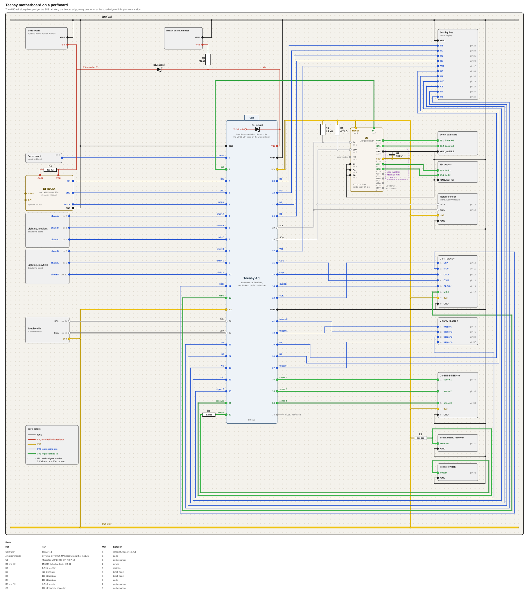

# Teensy motherboard

The Teensy motherboard carries the Teensy and the DFR0954 amplifier module. It hands the Teensy's rails on to the subsystems. The port expander sits on a board of its own, which J-PE-TEENSY joins to the motherboard.

The Teensy's edge headers offer two 3V3 pins and three GND pins. Six subsystems run from the Teensy's 3V3. Seven cables and the contacts carry the Teensy's ground. The board spreads both over a rail each.

## Circuit

### Supply

J-MB-PWR takes 5 V and GND from the power board's [J-MAIN](../power/design.md#outputs). Its GND joins the GND rail.

The Teensy runs from this 5 V or from USB alone. Its trace between VUSB and VIN is cut. Two diodes feed VIN from either source and keep the sources apart:

- D1 is a 1N5819 between J-MB-PWR's 5 V and VIN. While the machine is off, it keeps USB from feeding the power board.
- D2 is a 1N5819 soldered onto the Teensy, from the VUSB hole beside its USB socket to its VIN pin or pad. It prevents the power board feeding the USB.

The DFR0954 takes its 5 V ahead of D1, so it stays off on USB alone. The node behind D1 feeds both the Teensy's VIN and R2 of the break beam.

### 3V3 rail

The 3V3 rail starts at the Teensy's two 3V3 pins and feeds these subsystems.

| Subsystem | What the 3V3 feeds |
|---|---|
| [IR sensing](../ir-reflective/design.md) | the isolator's Teensy side, over the isolator board's J-IR-TEENSY |
| [Solenoids](../solenoid/design.md) | the foil, over the sense board's J-SENSE-TEENSY |
| [Break beam](../break-beam/design.md) | R3, the receiver's pull-up |
| [Magnetic rotary sensor](../magnetic-rotary/design.md) | the module |
| [Display](../display/design.md) | the touch converter's LV side, over the touch cable |
| [Port expander](../port-expander/design.md) | U1 and the bus pull-ups R5 and R6, over J-PE-TEENSY |

### GND rail

The GND rail joins the Teensy's three GND pins, the DFR0954's GND and J-MB-PWR's GND. These cables take their ground from it: J-IR-TEENSY of the IR isolator board, J-SENSE-TEENSY of the solenoid sense board, J-PE-TEENSY of the port expander board, the rotary sensor's cable, the display bus, the break beam's emitter, its receiver and the toggle switch. The contacts take theirs from the port expander board.

### Toggle switch

R1 sits on the motherboard in series between pin [32](../../pin-assignment.md "Toggle switch") and the toggle switch. The [controls design](../controls/design.md) sets its value.

### Break beam

R2 feeds the break beam's emitter from the supply behind D1. R3 pulls pin [31](../../pin-assignment.md "Receiver output of the ball drain gate") up to the 3V3 rail. The [break-beam design](../break-beam/design.md) sets both values.

### Audio

The DFR0954 sits beside the Teensy. Pins [2](../../pin-assignment.md "DIN to the DFR0954"), [3](../../pin-assignment.md "LRC to the DFR0954") and [4](../../pin-assignment.md "BCLK to the DFR0954") drive it over I²S on the board. R4 sits between its GAIN and VCC pins. The [audio design](../audio/design.md) sets its value.

### Port expander

J-PE-TEENSY carries INT from pin [1](../../pin-assignment.md "Interrupt from the port expander"), SCL from pin [19](../../pin-assignment.md "SCL on Wire"), SDA from pin [18](../../pin-assignment.md "SDA on Wire"), 3V3 and GND to the port expander board, on pins 1 to 5. U1, R5, R6 and C1 sit there. The [port expander design](../port-expander/design.md) describes them.

### Contacts

The drain ball store's front foil comes in at E-1 and its back foil at E-2. Both inputs sit on the port expander board, where the store's wall foil takes its ground. The [contacts design](../contacts/design.md#drain-ball-store) describes the foils.

The two bells come in at E-3 and E-4. They are [hit targets](../contacts/design.md#hit-targets). Their foil takes its ground on the port expander board.

## Part list

Each part on the board is listed and counted by the subsystem it serves.

| Qty | Part | Where | Listed in |
|---|---|---|---|
| 1 | Teensy 4.1 | in socket headers in the middle of the board | [`research/teensy-4.1.md`](../../research/teensy-4.1.md) |
| 1 | DFRobot DFR0954, MAX98357A amplifier module | in socket headers beside the Teensy | [audio](../audio/design.md#part-list) |
| 1 | Microchip MCP23008-E/P, PDIP-18 | U1, on the port expander board | [port expander](../port-expander/design.md#part-list) |
| 2 | 1N5819 Schottky diode, DO-41 | D1, D2 | [power](../power/design.md) |
| 1 | 1.2 kΩ resistor | R1 | [controls](../controls/design.md#part-list) |
| 1 | 220 Ω resistor | R2 | [break beam](../break-beam/design.md#part-list) |
| 1 | 100 kΩ resistor | R3 | [break beam](../break-beam/design.md#part-list) |
| 1 | 100 kΩ resistor | R4 | [audio](../audio/design.md#part-list) |
| 2 | 4.7 kΩ resistor | R5, R6, on the port expander board | [port expander](../port-expander/design.md#part-list) |
| 1 | 100 nF ceramic capacitor | C1, on the port expander board | [port expander](../port-expander/design.md#part-list) |
