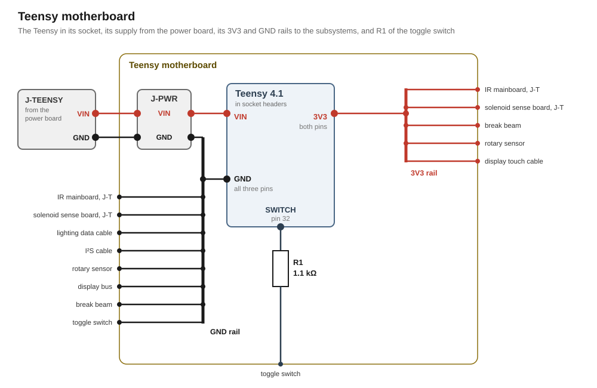

# Teensy motherboard

The Teensy motherboard carries the Teensy and hands its rails on to the subsystems. The Teensy sits in socket headers on it, so it comes off the board whole.

The Teensy's edge headers offer two 3V3 pins and three GND pins. Five subsystems run from the Teensy's 3V3. Eight cables carry the Teensy's ground. The board spreads both over a rail each.

## Circuit

### Supply

J-PWR takes 5 V and GND from the power board's [J-TEENSY](../power/design.md#outputs). Its 5 V feeds the Teensy's VIN. Its GND joins the GND rail.

### 3V3 rail

The 3V3 rail starts at the Teensy's two 3V3 pins and feeds these subsystems.

| Subsystem | What the 3V3 feeds |
|---|---|
| [IR sensing](../ir-reflective/design.md) | the isolator's Teensy side, over the mainboard's J-T |
| [Solenoids](../solenoid/design.md) | the foil, over the sense board's J-T |
| [Break beam](../break-beam/design.md) | both bodies |
| [Magnetic rotary sensor](../magnetic-rotary/design.md) | the module |
| [Display](../display/design.md) | the touch converter's LV side, over the touch cable |

### GND rail

The GND rail joins the Teensy's three GND pins and J-PWR's GND. These cables take their ground from it: the IR mainboard's J-T, the solenoid sense board's J-T, the lighting data cable, the I²S cable, the rotary sensor's cable, the display bus, the break beam and the toggle switch.

### Toggle switch

R1 sits on the motherboard in series between pin [32](../../pin-assignment.md "Toggle switch") and the toggle switch. The [controls design](../controls/design.md) sets its value.
