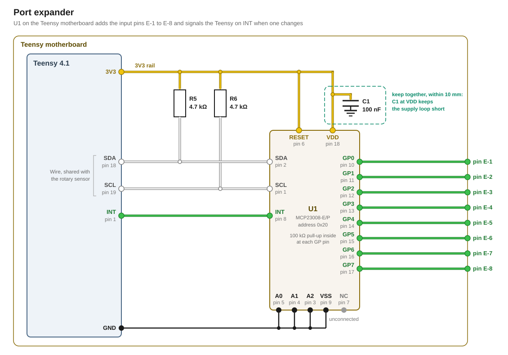

# Port expander

The port expander gives the Teensy eight more inputs. An MCP23008 reads them and signals the Teensy on an interrupt line when one changes. The Teensy then reads the inputs over I²C.

## Circuit

U1, R5, R6 and C1 sit on the [Teensy motherboard](../motherboard/design.md).



### Signal

U1 is an MCP23008-E/P in a DIP-18 package. It sits on `Wire`, the Teensy's first I²C port, with SDA on pin [18](../../pin-assignment.md "SDA on Wire") and SCL on pin [19](../../pin-assignment.md "SCL on Wire"). The [magnetic rotary sensor](../magnetic-rotary/design.md) shares the bus. U1's address pins A0, A1 and A2 sit at GND, which gives it the address 0x20. The rotary sensor answers at 0x36.

U1 and the Teensy only pull SDA and SCL low. R5 and R6 pull the lines back up to the 3V3 rail.

INT goes to pin [1](../../pin-assignment.md "Interrupt from the port expander"). U1 pulls INT low when an input changes. RESET sits at VDD.

U1's inputs GP0 to GP7 are the pins E-1 to E-8. Each takes a target's contact that closes to GND. U1's internal pull-up of 100 kΩ holds an open input high. The firmware switches the pull-up on at every input, so an input without a target stays high as well.

### Supply

VDD comes from the motherboard's 3V3 rail. C1, a 100 nF ceramic, decouples VDD and sits within 10 mm of it.

## Firmware

When INT goes low, the firmware reads the inputs over `Wire`. The read clears INT. [`docs/firmware/io/port-expander.md`](../../firmware/io/port-expander.md) describes how the firmware reads the pins.

## Part list

| Qty | Part | Where |
|---|---|---|
| 1 | Microchip MCP23008-E/P, PDIP-18 | U1 |
| 1 | 100 nF ceramic | C1, at U1's VDD |
| 2 | 4.7 kΩ | R5 and R6, from SDA and SCL to 3V3 |

## Appendix: derivations

Every figure below is recomputed by [`figures.py`](figures.py) from the inputs it names, and `tools/figcheck.py` compares each one against the line that states it.

### Bus

```
BUS       the rotary module's pull-up              4.7 kΩ
          R5 and R6 on the motherboard             4.7 kΩ
          the two in parallel                    = 2.35 kΩ
          the rotary sensor's side, each line      39 pF
          U1 and the motherboard, each line,
          assumed                                  100 pF
          each bus line in all                   = 139 pF
          what U1 allows on SDA                    400 pF
          a rising edge between the low and the
          high input level                       = 276 ns
          the same with R5 and R6 alone, on the
          motherboard's load alone              = 399 ns
          what Standard-mode allows                1000 ns
          the Teensy's own pull-up                 22 kΩ
          every pull-up in parallel              = 2.12 kΩ
          the Teensy's 3.3 V at most               3.333 V
          what a device sinks to hold a line
          low, at most                           = 1.57 mA
          what an I²C output has to sink           3 mA
```

### Read

```
READ      the bus clock                            100 kHz
          one byte on the bus                      9 bits
          the bytes of one read, the address,
          INTF's address, the address again,
          INTF, INTCAP and GPIO                    6 bytes
          one read, with its START, repeated
          START and STOP                         = 570 µs
          a read of the rotary sensor, which it
          may wait for                             290 µs
          the read the driver tick requests,
          every                                    100 ms
          the share of the bus that takes        = 0.57 %
```

### Supply

```
SUPPLY    U1's supply range in Standard-mode,
          from                                     1.8 V
          up to                                    5.5 V
          U1's current, at most                    1 mA
          an input's pull-up into a closed
          contact, at most                         115 µA
          the eight inputs                       = 0.92 mA
          R5 and R6 while both lines are low     = 1.42 mA
          U1, R5 and R6 on the Teensy's 3V3      = 3.34 mA
```

## Sources

- [`datasheets/MCP23008-MCP23S08-Microchip.pdf`](../../datasheets/MCP23008-MCP23S08-Microchip.pdf), DS20001919F: the pins, the address, the reset, the interrupt output, the internal pull-ups, the supply range and current, and the load SDA allows
- [`datasheets/UM10204-NXP.pdf`](../../datasheets/UM10204-NXP.pdf): the I²C specification, Rev. 7.0, with the current an output has to sink in Table 10
- [`magnetic-rotary/design.md`](../magnetic-rotary/design.md#bus): the rotary module's pull-up, its cable and the Standard-mode rise time
- [`research/teensy-4.1.md`](../../research/teensy-4.1.md): the Teensy's own pull-up and the 3.3 V rail
