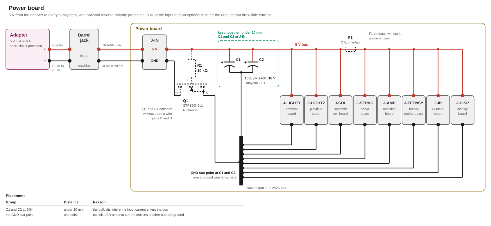

# Power supply

The power board takes the 5 V of an external adapter and passes it to every subsystem of the machine. It holds the rail through load steps.

## Requirements

- The machine runs from a 5 V adapter of 3 A or of 6 A.
- Every subsystem takes its 5 V and its ground over a separate pair from one point on the board.
- With the optional switch fitted, plus and minus swapped at the input damage nothing, whether the adapter or the wiring to J-IN swaps them.
- The rail stays inside the range every subsystem accepts, at power-up and at every load step.

## Adapter

The adapter needs short-circuit and overload protection. A short on any output is the adapter's to interrupt. The overload protection shuts the adapter down under a lasting load above its rating, which the lighting's 6 A profile puts on a smaller adapter. At its full current it has to deliver at least 5.0 V at the jack. With no load it may put out up to 5.25 V. The 5.0 V are the starting point of every subsystem's lowest supply voltage.

## Loads

| Load | Current |
|---|---|
| The Teensy, the amplifier, the IR mainboard and the display, which draw all the time | 902 mA |
| The lighting at its cap, with the 3 A adapter | 2.0 A |
| The lighting at its cap, with the 6 A adapter | 2.93 A |
| Three coils pulling at once, for at most 30 ms | 2.17 A |
| The servo stalled | 0.8 A |
| The most that draws at once, with the 3 A adapter's cap | 5.07 A |
| The most that draws at once, with the 6 A adapter's cap | 6.0 A |

One ball triggers at most two bumpers within one pull-in, however fast it is, while a second ball may sit in the scoop and be ejected at the same moment. Three coils are therefore the most that pull at once: two bumpers and the scoop. The servo moves only while no coil pulls, which the game holds to.

## Circuit



### Input

The adapter's plug goes into the machine's barrel jack, which has to be rated for the adapter's current. A 16 AWG pair of at most 30 cm takes the 5 V from the jack to J-IN on the board.

C1 and C2 keep the rail steady when the load steps. They are low-impedance electrolytics of 29 mΩ each. That keeps the rail above every subsystem's lowest supply voltage when the lighting, the coils or the servo start. Their 2000 µF keep the rail under the 5.5 V the Teensy's VIN takes when the whole load stops. They sit within 20 mm of J-IN.

### Input protection

The board proposes an optional protection against swapped polarity. Q1 protects the machine against swapped polarity at J-IN. It is an N-channel MOSFET in the ground line, with its drain at the adapter's negative and its source on the board's ground. R1 ties its gate to the 5 V bus, so Q1 conducts with the right polarity and stays off with swapped polarity. Q1 and R1 are optional. Without them a wire joins J-IN's negative to the board's ground. Every figure of this design is derived with Q1 fitted, and leaving it out only raises the bus.

F1 is an optional 2 A time-lag fuse in the 5 V of J-SERVO, J-MAIN, J-IR and J-DISP protecting their wires. Any T2A that drops at most 242 mV at 2 A fits. J-LIGHT1, J-LIGHT2 and J-SOL stay without a fuse, because this would cost voltage that the coils and the lighting's buffers cannot spare.

> [!WARNING]
> Without Q1, swapped polarity at J-IN reaches every subsystem. It destroys the Teensy and the ICs on the boards.

> [!WARNING]
> The board has no overvoltage protection. An adapter above 5.5 V destroys the Teensy.

> [!WARNING]
> Without F1 the board has no fuse. J-LIGHT1, J-LIGHT2 and J-SOL rely on the adapter's overcurrent protection in any case.

With the Teensy on USB, the USB cable connects the machine's ground to the computer's ground. If the computer and the adapter are both earthed, part of the machine's current flows back through the USB cable instead of the adapter's cable. The computer can then lose the USB connection to the Teensy, but nothing gets damaged.

### Outputs

| Output | To | Current at most |
|---|---|---|
| J-LIGHT1, J-LIGHT2 | the ambient and the playfield lighting board | 2.0 A with the 3 A adapter, 2.93 A with the 6 A adapter, each |
| J-SOL | the solenoids' coil board | 2.85 A |
| J-SERVO | the servo board | 0.8 A |
| J-MAIN | the Teensy motherboard, with the Teensy and the amplifier module | 504 mA |
| J-IR | the D24V5F3 at the IR mainboard | 201 mA |
| J-DISP | the display board | 198 mA |

### Ground

Every output carries its own ground wire back to one point at C1 and C2. The coils, the LEDs and the servo return their currents there.

The adapter's negative reaches the machine through Q1 or its wire alone.

### Teensy Supply

J-MAIN carries 5 V to the [Teensy motherboard](../motherboard/design.md#supply). The Teensy's VIN takes it through D1. The amplifier module takes it ahead of D1.

The Teensy's VUSB-VIN trace is cut, as [`teensy-4.1.md`](../../research/teensy-4.1.md#powering-from-something-other-than-usb) requires for an external supply. D2 bridges the cut, so the Teensy also runs on USB alone.

### IR mainboard

J-IR carries 5 V to the IR mainboard. The Pololu D24V5F3 that makes the mainboard's 3.3 V is plugged into the board there, as the [IR design](../ir-reflective/design.md#supply-and-input-filter) requires. The module works from 3.4 V, which the end of the pair stays far above.

### Display

J-DISP carries 5 V to the display module, whose own regulator makes its 3.3 V, as the [display design](../display/design.md#supply) describes. The end of the pair stays at 4.77 V with the 6 A adapter, far above the 3.49 V that regulator needs.

### Wiring

Every output is rated for 22 AWG wiring. A 22 AWG wire carries at most 7 A, more than the 6 A adapter is rated for. 

For better performance, thicker wires can be used for DC-IN-to-board, the two J-LIGHT pairs and the ground star point. 

For better convenience, thinner wires such as 26 AWG can be used for low current consumers.


The 3 A adapter delivers less than the machine draws at its peak. With it, the lighting at its cap leaves no room for a coil. The lighting at its cap and three coils together ask for 2.07 A more than the adapter delivers, for at most 30 ms. For that moment the adapter limits its current, so the voltage drops. With the 6 A adapter, the lighting's cap leaves room for three coils at once.

## Part list

| Qty | Part | Where |
|---|---|---|
| 1 | STP160N3LL, N-channel MOSFET, TO-220 | Q1, the optional reverse-polarity switch in the ground line |
| 1 | 10 kΩ resistor | R1, with Q1, from its gate to the 5 V bus |
| 1 | T2A fuse, 2 A time-lag, 5 × 20 mm, in a 5 × 20 mm holder | F1, the optional fuse in the 5 V of J-SERVO, J-MAIN, J-IR and J-DISP |
| 2 | Rubycon 16ZLH1000MEFC8X20, 1000 µF, 16 V | C1 and C2, the bulk at J-IN |

## Appendix: derivations

[`figures.py`](figures.py) recomputes every figure below from its inputs. `tools/figcheck.py` checks each one against its line and each drawn figure through its `data-fig` anchor.

### Loads

```
LOADS     the smaller adapter                      3 A
          the larger adapter                       6 A
          the lighting's cap with the 3 A adapter  2.0 A
          and with the 6 A adapter                 2.93 A
          all four coils at once                   2.85 A
          one bumper coil                          0.68 A
          one pull-in, at most                     30 ms
          the servo stalled                        800 mA
          the amplifier at its capped output       129 mA
          the Teensy itself, PJRC's figure         100 mA
          its 3V3 pin at its full rating           250 mA
          the break beam's emitter on VIN, at
          most                                     25.2 mA
          the Teensy's VIN, behind a linear
          regulator, with the emitter            = 375 mA
          J-MAIN, with the amplifier             = 504 mA
          the IR mainboard, sixteen channels       222 mA
          at its module's highest output           3.432 V
          the module's efficiency, assumed         80 %
          the module's input current at its
          lowest input, which bounds J-IR's drop = 281 mA
          the module's input current             = 201 mA
          the display                              198 mA
          the permanent consumers                = 902 mA
          the most that draws at once, with the
          3 A adapter                            = 5.07 A
          with the 6 A adapter                   = 6.0 A
          the lighting at its 3 A cap with three
          coils, past the adapter                = 2.07 A
```

### Input path

```
INPUT     the adapter at the jack, at least        5.0 V
          the pair to the board                    30 cm
          16 AWG                                   13.17 mΩ/m
          the pair, both wires                   = 7.9 mΩ
          Q1's R_DS(on) at 25 °C                   4.2 mΩ
          the gate voltage that row needs          4.5 V
          Figure 10 at                             95 °C
          its factor there                       ≤ 1.4
          Q1's R_DS(on) below that junction      = 5.88 mΩ
          what Q1 dissipates at 6 A              = 0.22 W
          Q1's thermal resistance                  62.5 °C/W
          the air around it                        40 °C
          Q1's junction at 6 A                   = 53.3 °C
          Q1's leakage when it blocks              1 µA
          its gate's leakage, at most              100 nA
          the most R1 that still leaves the
          gate 4.5 V on the bus at 6 A           = 3.68 MΩ
          the board's wiring, both conductors,
          estimated                                5 mΩ
          the bus at 3 A, at least               = 4.94 V
          the bus at 6 A, at least               = 4.88 V
```

### Rail ceiling

```
RAIL      the adapter with no load, assumed        5.25 V
          the adapter's cable, from                1.0 m
          up to                                    2.0 m
          18 AWG, assumed for that cable           20.95 mΩ/m
          a loose pair's inductance                1 µH/m
          the cables at their longest            = 2.3 µH
          C1 and C2, each                          1000 µF
          together                               = 2000 µF
          with the lighting boards', the
          solenoid board's and the servo's bulk,
          the whole rail                             = 4200 µF
          each, its impedance                      29 mΩ
          together                               = 14.5 mΩ
          the whole 3 A released at once         = 5.36 V
          the whole 6 A released at once         = 5.46 V
          the same with one capacitor            = 5.54 V
          what the Teensy's VIN takes              5.5 V
          the cables at their shortest           = 54.8 mΩ
          the damping of a live plug-in          = 1.07
          the charging current at plug-in        = 79.7 A
          what Q1's package carries, Table 2       120 A
          the gate voltage at which Q1 takes
          over from its body diode, at most        2.5 V
```

### Fuse

```
FUSE      F1's rating                              2 A
          behind it at most, the servo stalled
          and the IR module at its lowest input  = 1.79 A
          the current F1 was measured at           1.6 A
          its drop there, measured                 55 mV
          a margin on that                         10 mV
          its resistance, at most                = 41 mΩ
          its drop behind the outputs, at most   = 73 mV
          what opens it within                     120 s
          that multiple of its rating              2.1×
          the current that opens it              = 4.2 A
          the most a T2A may drop at its rating  = 242 mV
```

### Supply floors

```
FLOORS    what the lighting's buffers need         4.5 V
          the lighting's buffers at 3 A          = 4.75 V
          the lighting's buffers at 6 A          = 4.61 V
          one wire of a cable with its contacts    0.1 Ω
          the servo's buffer while it stalls,
          at 3 A                                 = 4.69 V
          at 6 A                                 = 4.64 V
          and at its start, while C1 alone
          feeds the step                         = 4.58 V
          three coils at once                      2.17 A
          the solenoids' coil board while they pull,
          at 3 A                                 = 4.47 V
          at 6 A                                 = 4.42 V
          what a stock coil kicks down to          4.4 V
          D1 in front of the Teensy's VIN, a
          1N5819, at most                          0.60 V
          the Teensy's VIN at 6 A                = 4.11 V
          what it needs                            3.6 V
          on USB alone, a high-power port gives
          at least                                 4.75 V
          and at most                              500 mA
          D2 from VUSB to VIN, the same 1N5819
          the Teensy's VIN on USB alone          = 4.15 V
          the IR mainboard's module at 6 A       = 4.75 V
          what it needs                            3.4 V
          the display at 6 A                     = 4.77 V
          what its regulator needs, at least       3.49 V
```

### What a replacement part has to meet

```
ALLOW     the least bulk at J-IN that holds the
          6 A release under VIN's maximum       = 1325 µF
          the impedance at which the lighting's
          buffers touch their floor at 6 A      = 55.3 mΩ
          at which the solenoid board touches
          the coils' floor                      = 49.8 mΩ
          at which the servo's buffer touches
          its floor                             = 568 mΩ
          the least of them, the ceiling for a
          replacement part's listed impedance   = 49.8 mΩ
```

## Sources

- [Schurter FST 5x20](https://www.schurter.com/en/datasheet/typ_FST_5x20.pdf): the pre-arcing time to IEC 60127-2/3
- [ST STP160N3LL](../../datasheets/STP160N3LL-ST.pdf), DocID025073 Rev 3: the ratings in Table 2, the thermal resistance in Table 3, R_DS(on), the gate threshold and the leakage in Table 4, and Figure 10 for R_DS(on) against temperature
- [Pololu D24V5F3](https://www.pololu.com/product/2842): the typical efficiency of the IR mainboard's module
- [Rubycon ZLH](../../datasheets/ZLH-Rubycon.pdf): C1's and C2's impedance, 16ZLH1000MEFC8X20, read from [DigiKey's listing](https://www.digikey.de/en/products/result?keywords=16ZLH1000MEFC8X20)
- [PowerStream, wire gauge and current limits](https://www.powerstream.com/Wire_Size.htm): the chassis wiring current of 16 and 22 AWG
- ASTM B258: the resistance of 16 and 18 AWG annealed copper
- [`research/teensy-4.1.md`](../../research/teensy-4.1.md): VIN's range, the 3V3 pin's rating, the Teensy's own draw and the VUSB-VIN trace
- [`parts/lighting/design.md`](../lighting/design.md), [`parts/solenoid/design.md`](../solenoid/design.md), [`parts/servo/design.md`](../servo/design.md), [`parts/audio/design.md`](../audio/design.md), [`parts/ir-reflective/design.md`](../ir-reflective/design.md), [`parts/display/design.md`](../display/design.md): what each subsystem draws and the supply range it needs
