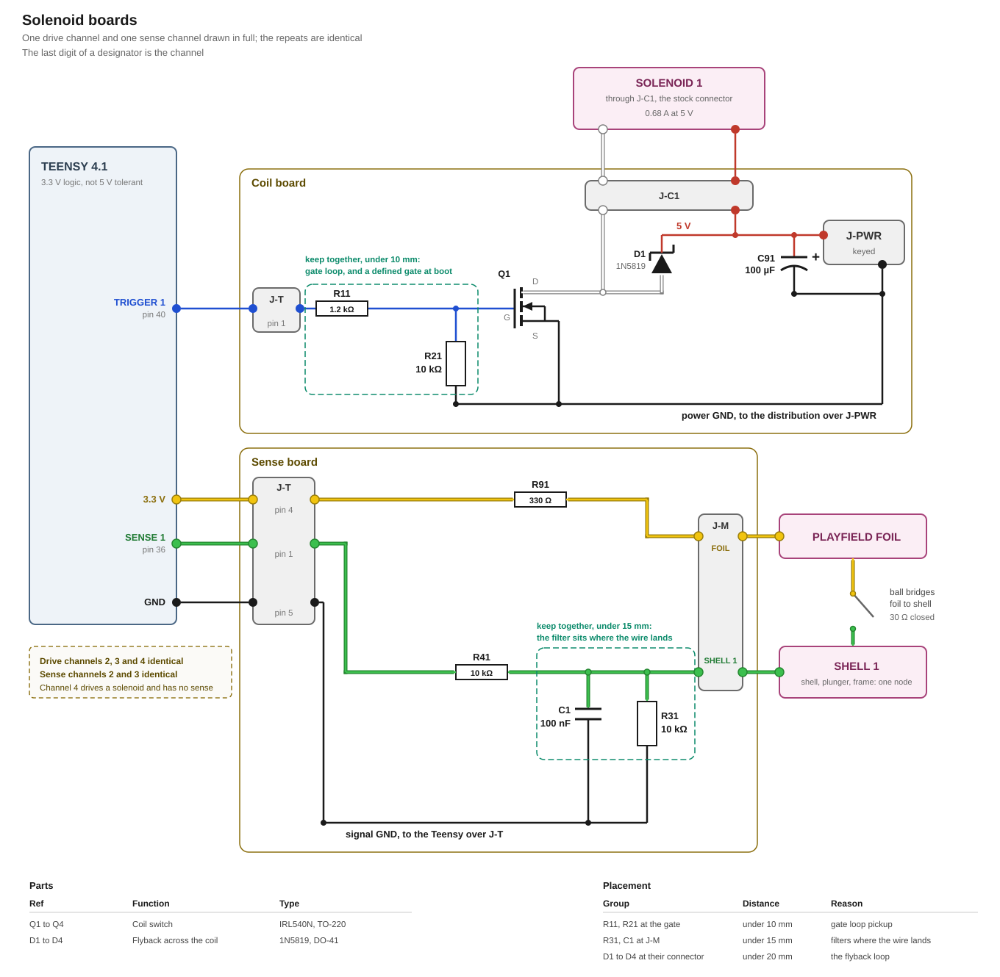

# Solenoids

This modification requires four solenoid channels. Three of them drive solenoids that carry a contact the ball closes, called sensed solenoids. These are the top bumpers taken from the stock machine. The fourth drives a solenoid without a contact, called an unsensed solenoid. It is an [Adafruit 3992](https://www.adafruit.com/product/3992) push-pull solenoid and belongs to a [scoop](https://missionpinball.org/latest/mechs/scoops/). The bumpers and the scoop are the [game components](../../firmware/game-abstraction.md#playfield-components) built on these solenoids.

Driving the sensed solenoids follows the same principle as the stock machine's bumpers, which is described in [`3_bumper-control.md`](../../research/Rokr/3_bumper-control.md).

A sensed solenoid fires when a ball closes a circuit between the conductive foil on the playfield and the metal shell of the solenoid itself. The firmware then energises the solenoid for a short moment and releases it.

With its return spring, the scoop's solenoid does not pull upward at the machine's 5 V, as its [measurements](../../research/Custom/adafruit-3992.md#measurements) show. It is built in without the spring and mounted pulling upward. Gravity returns its armature.

Two boards drive and sense them. The coil board carries the four drive channels. The sense board carries the three sense channels. Below the schematic of both boards. The last digit of a component is the channel it belongs to. Q1, D1, R11 and R21 make up drive channel 1, and R31, R41 and C1 make up sense channel 1.



## Requirements

- The driver triggers a sensed solenoid, not the game logic.
- The game logic can fire a single solenoid itself.
- A pull lasts long enough to kick the ball away, and short enough that a ball can be fired back and forth between the three top bumpers.
- The solenoids are guarded against being held in. Their vendor and their specifications are unknown, so none is ever energised for longer than five seconds.

## Drive

Each channel switches its coil on the low side with an N-channel MOSFET. The gate hangs on a Teensy pin through a series resistor that bounds what the pin drives at the switching moment. A pull-down resistor pulls the gate to ground whenever the Teensy does not drive the pin, and the coil is then off. This holds while the Teensy is unpowered and after a reset. After a reset, a weak circuit inside the Teensy pin, its keeper, still tries to hold the pin at its last level. The pull-down is strong enough to win against it, so a coil that was on at the reset turns off. A Schottky diode across the coil takes the winding current at switch-off, which holds the drain of the MOSFET a diode drop above the rail. For each solenoid the drive channels are built identical.

The MOSFET is an IRL540N. Its sheet specifies R_DS(on) only from 4.0 V at the gate, more than a Teensy pin gives. The drop across it is taken from the sheet's typical curve at 2.5 V, which the gate clears.

## Sense

The foil is one sheet on the playfield, fed from 3.3 V through R91. That resistor protects unlikely short circuits if anything other than the designed sense channels grounds the foil.


Each sensed solenoid's shell reaches the sense board on a separate wire. A pull-down holds that wire at ground until a ball bridges foil and shell and pulls it up to the rail. A capacitor at the terminal filters what the playfield wire brings in, and a series resistor carries it on to the Teensy pin. A fault that ties a sense wire to a coil wire puts 5 V on that node. R41 to R43 are 10 kΩ, sized for the worst case (the Teensy unpowered) to keep the resulting current under the 1 mA PJRC calls very unlikely to cause harm.

## Supply

The four coils draw from the central 5 V power distribution, brought in at J-COIL-PWR. The three sense channels are driven directly from the Teensy, since their current draw is next to nothing. That keeps every sense net dead whenever the Teensy is dead. The two supply rails sit on separate boards.

Each board has its own ground net. The sense channels sit on the signal ground, which reaches the Teensy over the sense board's J-SENSE-TEENSY. The MOSFETs, the flyback diodes, the gate pull-downs and C91 sit on the coil board's power ground, which reaches the distribution over J-COIL-PWR. J-COIL-TEENSY on the coil board carries no ground.

> On the bench, with the Teensy on USB, the coil board's GND must be joined with the Teensy's GND.

**C91, 100 µF at J-COIL-PWR**, absorbs the feed cable's own inductive kick when a coil switches off, keeping it off the coil board's copper.

The [power board](../power/design.md) holds the rail. With the three bumpers pulling at once, J-COIL-PWR stays above the 4.4 V a stock coil needs for its kick.

## Boards

### Connectors

Both boards sit near the three bumpers.

| Board | Connector | Poles | To |
|---|---|---|---|
| Coil board | **J-COIL-PWR** | 2 | 5 V and GND from the power distribution |
| | **J-COIL-TEENSY** | 4 | The Teensy |
| | **J-C1** to **J-C4** | 2 each | 5 V and the MOSFET's drain to the solenoids |
| Sense board | **J-SENSE-TEENSY** | 5 | The Teensy |
| | **J-M** | 4 | Open wires with eyelets. One 3V for the foil and the three eyelets unpowered to the solenoid shells. |

J-COIL-TEENSY on the coil board carries trigger 1 to trigger 4 from the Teensy, in that order. J-SENSE-TEENSY on the sense board carries the three senses, the Teensy's 3V3 and its ground.

| J-SENSE-TEENSY pin | Signal | Direction |
|---|---|---|
| 1 | Sense 1 | board to the Teensy |
| 2 | Sense 2 | board to the Teensy |
| 3 | Sense 3 | board to the Teensy |
| 4 | 3V3 | the Teensy's rail, feeding the foil through R91 |
| 5 | GND | the Teensy's ground, beside the signals |

> Before the Teensy is plugged in for the first time, every pin of J-COIL-TEENSY and J-SENSE-TEENSY should be measured against J-COIL-PWR's GND with J-COIL-PWR powered and both open. All values must read 0 V. Anything else means the 5 V side has reached the connector and would kill an unpowered Teensy.

### Layout

The coil wiring and the sense wiring should be routed with distance from each other in order to prevent the sense channels from being influenced by solenoids pulling. The signal ground net and the power ground net are separated.

The following parts should be placed close to each other forming a group:

| Group | Why |
|---|---|
| R11 and R21 at the gate of Q1 | A long loop here lets switching noise couple into the gate, which R21 might not hold down fast enough |
| R31 and C1 at J-M | Placed further away, the wire between the terminal and the filter would carry the signal unfiltered, and pick up more noise on the way |
| D1 at J-C1 | A long loop here adds inductance to the flyback path itself, raising the voltage spike at switch-off |

## Teensy pins

| Signal | What the pin has to be |
|---|---|
| Four triggers | A plain digital output. A pull-in is a level held for a measured time, so none of them needs PWM |
| Three senses | A plain digital input that can interrupt on both edges |

Which pins carry them, and what each one costs elsewhere in the build, is in [`pin-assignment.md`](../../pin-assignment.md).

## Firmware

The driver is responsible for sensing and firing solenoids. It also ensures that solenoids can not be permanently pulled and thus protected from overheat and damage. 

Controlling the hardware is handled by interrupt handlers. The sensed solenoids are triggered automatically upon sense. The unsensed solenoid is controlled by the game logic.

[`docs/firmware/drivers/solenoid.md`](../../firmware/drivers/solenoid.md) describes the driver.

## Part list

| Qty | Part | Where |
|---|---|---|
| 4 | IRL540N logic-level MOSFET, N-channel, TO-220 | **Q1** to **Q4**, coil switches |
| 4 | 1N5819 Schottky diode, DO-41 | **D1** to **D4**, across each coil |
| 10 | 10 kΩ resistor | **R21** to **R24** gate pull-down, **R31** to **R33** sense pull-down, **R41** to **R43** sense series |
| 4 | 1.2 kΩ resistor | **R11** to **R14**, gate |
| 3 | 100 nF ceramic capacitor | **C1** to **C3**, sense filter |
| 1 | 330 Ω resistor | **R91**, foil feed |
| 1 | KEMET ESL107M016AC3AA, 100 µF, 16 V | **C91**, bulk at J-COIL-PWR |

## Appendix: derivations

Every figure below is recomputed by [`figures.py`](figures.py) from the inputs it names, and `tools/figcheck.py` compares each one against the line that states it. The drawn figures carry a `data-fig` anchor and are checked the same way.

**The drive channel.** What the Teensy pin sees, what the gate sees, and what the drain sees.

```
V_GATE    the Teensy's rail                       3.3 V
          within                                  1 %
          R_gate to ground                        10 kΩ
          each resistor of the channel within     5 %
          the rail at its low end across R_gate
          at its high end and R_gate to ground at
          its low end, the gate while it is on  = 2.88 V
          the gate threshold, worst case          2.0 V
          the gate voltage of the curve R_DS(on)
          is read off, which the gate clears       2.5 V
          what the gate clears it by, with no coil
          current in the grounds                = 384 mV
          the gate-source rating                  16 V
          after a reset the pin's keeper holds the
          level the pin last drove, at its
          strongest through                       105 kΩ
          the gate while it holds a high, the
          rail at its high end                  = 0.31 V
          the pin then                          = 0.34 V
          the input's low level, 0.3 × the rail
          at its low end                        = 0.98 V
          the most R_gate to ground that holds
          the gate under the lowest turn-on
          threshold against the keeper          = 43.3 kΩ
I_PIN     R_gate                                  1.2 kΩ
          the rail at its high end across it at
          its low end, at the switching moment  = 2.9 mA
          the same across both resistors, held  = 313 µA
          what PJRC allows on one pin             4 mA
          the least R_gate that holds the pin
          there                                 = 0.88 kΩ
          R_gate at its high end × 1800 pF, the
          gate settling                         = 2.27 µs
V_KICK    a step on the drain lifts the gate through
          the capacitive divider of the part itself,
          taken at the largest step the drain makes,
          which is the clamped switch-off:
          input capacitance                       1800 pF
          reverse transfer capacitance            170 pF
          5.60 V × 170 pF / 1800 pF             = 0.529 V
          the gate threshold, lowest              1.0 V
          R_gate to ground × 1800 pF, over which a
          drain step has to be short for that
          figure to hold                        = 18.0 µs
          which is the case at switch-off and not
          when the rail comes up behind C91
V_DRAIN   the machine's rail, measured            5 V
          a stock coil kicks down to, measured   4.4 V
          the diode's forward drop at 1 A         0.60 V
          the drain at switch-off, clamped      = 5.60 V
          the MOSFET's drain-source rating        100 V
          the diode's reverse rating              40 V
P_Q       R_DS(on), typical, read off the 2.5 V
          curve at 1 A                            120 mΩ
          the scoop's coil, the largest of the
          four and the worst case for a channel   0.806 A
          that current × 120 mΩ, the drop
          across Q                              = 96.8 mV
          that current² × 120 mΩ, while energised = 78.0 mW
          its junction-to-ambient resistance      62 °C/W
          the air inside the machine, at most     40 °C
          the junction then                     = 44.9 °C
          what the junction may reach             175 °C
I_CH      the coil, measured                      0.68 A
          the scoop's coil, measured              6.2 Ω
          the machine's rail across it          = 0.806 A
          the diode's average forward current      1 A
          its surge rating                        30 A
          the MOSFET's continuous drain current   26 A
I_FEED    3 stock channels at 0.68 A plus the
          scoop's 0.806 A, the unarbitrated demand
          the protection interrupts             = 2.85 A
          two bumpers off one ball and the scoop
          ejecting the other, the most that pull
          at once in play                       = 2.17 A
```

**The sense channel.** What a closed contact puts on the pin, and how fast the node follows.

```
V_SENSE   the contact from foil to shell,
          measured at its worst point             30 Ω
          R91 in the foil feed, shared            330 Ω
          R_pulldown, one per channel             10 kΩ
          the pin with one ball on a shell      = 3.19 V
          the pin with all three closed, which
          loads R91 three ways                  = 2.99 V
          the pin with no ball                     0 V
          the input's high level, 0.7 × the rail = 2.31 V
          the least R_pulldown that keeps all
          three closed above it, each resistor
          5 % off where it hurts                = 2.63 kΩ
          the most R91 that does                = 1.28 kΩ
R_S       between the node and the Teensy pin     10 kΩ
          how far a pin may go past its rail,
          its absolute maximum                    0.30 V
          the rail plus that, where a powered
          pin clamps                            = 3.60 V
          5 V through the series resistor into an
          unpowered pin, whose ceiling is that
          0.30 V alone                          = 0.470 mA
          what PJRC calls unlikely to harm        1 mA
          the adapter with no load, at most       5.25 V
          the least series resistor that holds
          the pin under 1 mA from that rail, 5 %
          under its value                       = 5.22 kΩ
I_FOIL    3.3 V through one closed branch       = 0.319 mA
          all three closed together             = 0.898 mA
          what the Teensy's 3V3 pin allows        250 mA
          3.3 V / 330 Ω, the foil held at ground = 10 mA
          the same fault inside R91             = 33 mW
          a foil meeting a coil wire instead,
          into an unpowered 3.3 V rail          = 14.2 mA
          the least R91 that keeps that fault
          under half the 0.25 W the kit rates
          it, the rail at its high end          = 93.6 Ω
T_SENSE   C_filter at the terminal                100 nF
          10 kΩ × 100 nF, the node falling      = 1000 µs
          R91 and the contact into the same
          capacitor, the node rising            = 36 µs
          the ball                                9 mm
          the fastest ball the build assumes      3 m/s
          9 mm / 3 m/s, how long a contact lasts = 3 ms
          the largest filter whose node still
          falls inside that                     = 300 nF
          the most R_pulldown that does         = 28.5 kΩ
          the window in which further edges on
          the same channel are the same hit       10 ms
```

**The supply.** What the bulk capacitor covers, and the stock machine it is measured against.

```
C_BULK    the most the Teensy's VIN takes         5.5 V
          how far the rail may rise             = 0.5 V
          the feed from the distribution,
          estimated from its length                0.3 µH
          the scoop's coil, the largest current
          the feed carries                        0.806 A
          the least bulk that holds the rise at
          switch-off to that                    = 1.98 µF
          C91                                     100 µF
          rated at                                16 V
          its impedance, from the listing         230 mΩ
          0.806 A across the feed into C91, the
          rail lifted at switch-off             = 230 mV
          the drain then                        = 5.83 V
          the board's own copper with C91
          unfitted, estimated                      2 nF
          the same charge into that instead     = 9.88 V
          the stock machine's bulk                200 µF
          the three stock coils it carries      = 2.04 A
FAULT     a coil pair shorted in the loom,
          estimated from the conductor             0.2 Ω
          5 V across it and the switch          = 15.6 A
          that current through R_DS(on)         = 29.3 W
          what practice leaves of a per-contact
          rating                                   80 %
GND       one wire of a cable with its two
          contacts, every wire the same,
          estimated                                0.1 Ω
          all four coils at once                  2.85 A
          the power ground over the distribution,
          all of it on J-COIL-PWR's ground wire       = 285 mV
          the gate with that rise against it     = 2.63 V
          what it still clears 2.5 V by          = 133 mV
          the most R_gate that still clears it   = 1.74 kΩ
          the least R_gate to ground that does   = 6.88 kΩ
```

**The coil.** What one pull-in costs, what the enforced duty leaves, and how long a coil stays on when the driver tick never releases it.

```
DUTY      5 V × 0.68 A, while energised         = 3.4 W
          the longest pull-in the driver commands  30 ms
          how far past that a coil may run
          before the loop counts it overdue        1 ms
          the longest a pull-in therefore lasts = 31 ms
          the cool-down after a release, before
          the coil may fire again                  10 ms
          that and the pull-in together         = 41 ms
          the first over the second             = 75.6 %
          3.4 W over the same fraction          = 2.57 W
HOLD      the watchdog timeout, after which the
          restart releases a coil still on         2 s
          that and the longest pull-in, how long
          a coil the tick never releases stays on = 2.031 s
          the limit from the requirements          5 s
```

## Sources

- [`research/Rokr/3_bumper-control.md`](../../research/Rokr/3_bumper-control.md): the coil measurements, the contact resistance, the conductive-foil mechanism, the stock trigger circuit and the wiring that leaves the stock board
- [`research/Rokr/1_power-supply.md`](../../research/Rokr/1_power-supply.md): the machine's 5 V rail and the stock load inventory
- [`research/teensy-4.1.md`](../../research/teensy-4.1.md): 3.3 V logic, the per-pin current, the 3.3 V rail available to external circuits, and what reaches an unpowered pin
- [Infineon IRL540NPbF](../../datasheets/IRL540N-Infineon.pdf), Rev. 2.1: the ratings, the gate threshold, the capacitances, the typical output curve at 2.5 V and the thermal resistance
- [Taiwan Semiconductor 1N5817 to 1N5819](../../datasheets/1N5817-1N5819-TSC.pdf), Version H2104: the 1N5819 column of the absolute maximum ratings and the electrical specifications
- [NXP i.MX RT1060 Crossover Processors for Consumer Products](../../datasheets/IMXRT1060CEC.pdf), Rev. 4: the GPIO high-level input voltage, given as 0.7 × NVCC_XXXX
- [`research/Custom/adafruit-3992.md`](../../research/Custom/adafruit-3992.md): the scoop's solenoid, its coil resistance and how it pulls with and without its return spring
- [`pin-assignment.md`](../../pin-assignment.md): which pins were free, and what each one costs
- [`docs/firmware/driver-design.md`](../../firmware/driver-design.md): that a sensed solenoid is fired inside its interrupt and reports afterwards
