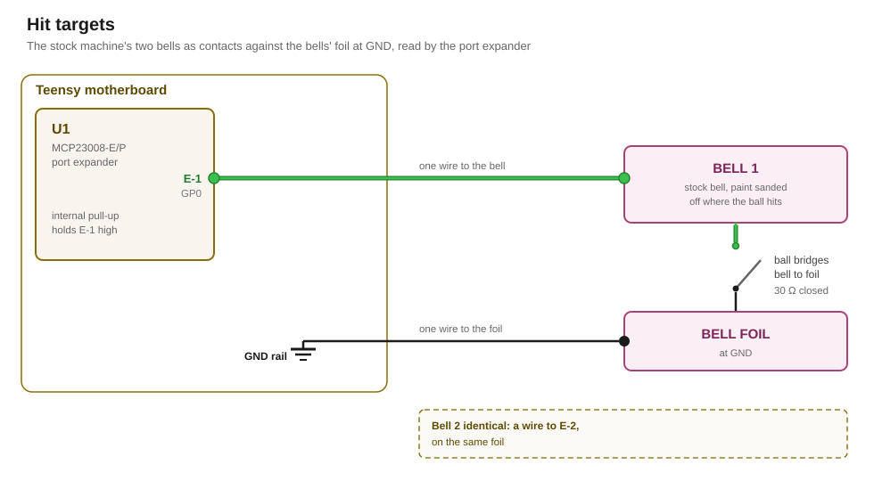

# Hit targets

A hit target is a contact that the ball closes when it hits the target.

## Hit target designs

### Bells

The stock machine has two bells. To reuse them as hit targets, each bell needs to form a contact with a conductive foil at GND. A ball that hits a bell touches the foil and the bell at once. The bell then sits at GND.

The bells therefore need to have their paint removed with sandpaper, so the ball meets bare metal there. The foil comes from the spare parts of the stock machine and is glued onto the playfield. Because of the targets' design, this foil must not touch the bumper foil.

Bell 1 is wired to the input E-1 of the port expander and bell 2 to E-2. The foil is wired to the GND rail of the [Teensy motherboard](../motherboard/design.md).

### Stand-up targets

> [!TODO]

## Circuit



### Signal

Each hit target closes an input of the [port expander](../port-expander/design.md) U1 to GND. U1's internal pull-up holds an open input high. A closed target pulls its input under U1's low threshold.

U1 copies its inputs at every change, so a closure reaches the Teensy however short it is.

## Firmware

The [contact driver](../../firmware/drivers/contacts.md) publishes each hit as `ContactClosed` from source `0` or `1`.

## Appendix: derivations

[`figures.py`](figures.py) recomputes every figure below from its inputs, and `tools/figcheck.py` compares each one against the line that states it.

### Levels

```
LEVELS    U1's weak pull-up current, at most       115 µA
          the ball's contact, as at a shell        30 Ω
          a touched bell's input, at most        = 3.5 mV
          the 3V3 rail, at least                   3.267 V
          U1's low threshold, of the rail          20 %
          that threshold, at least               = 0.65 V
          the ball's contact, at most            = 5.68 kΩ
```

## Sources

- [`datasheets/MCP23008-MCP23S08-Microchip.pdf`](../../datasheets/MCP23008-MCP23S08-Microchip.pdf), DS20001919F: the low threshold D031 and the pull-up current D070
- [`parts/solenoid/design.md`](../solenoid/design.md#sense): the ball's measured contact between foil and shell
- [`parts/port-expander/design.md`](../port-expander/design.md): U1 and its inputs
- [`research/teensy-4.1.md`](../../research/teensy-4.1.md): the 3V3 rail
